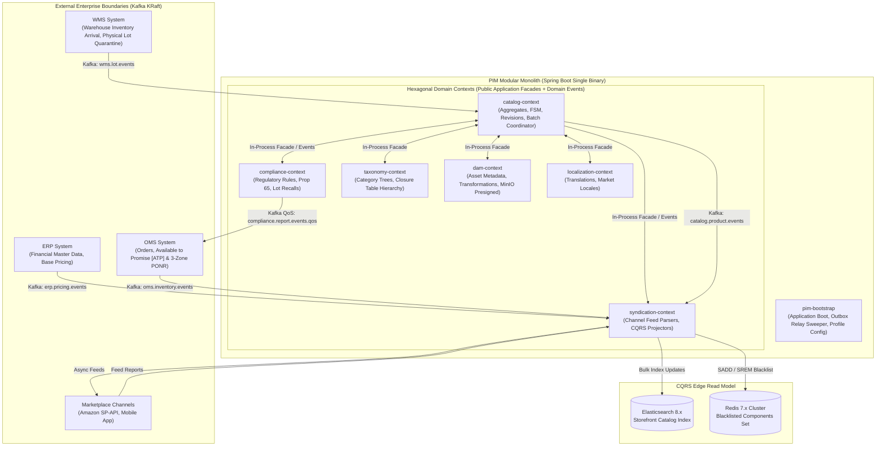
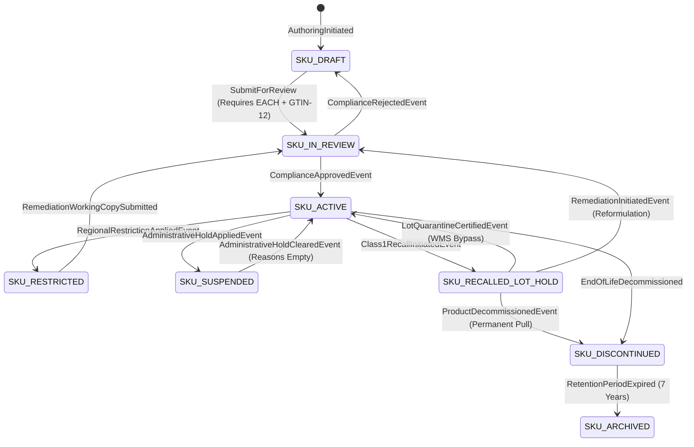
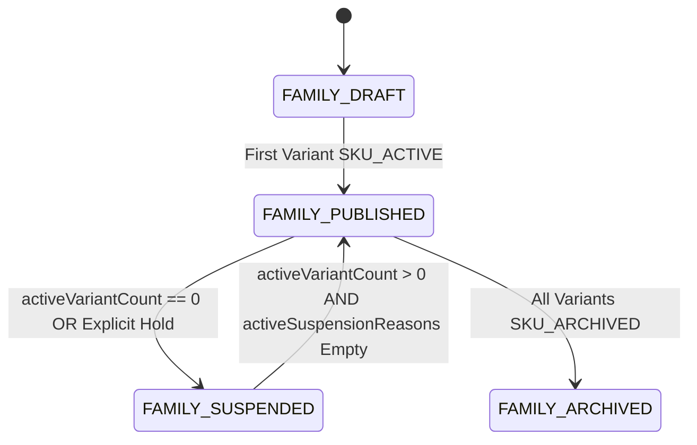
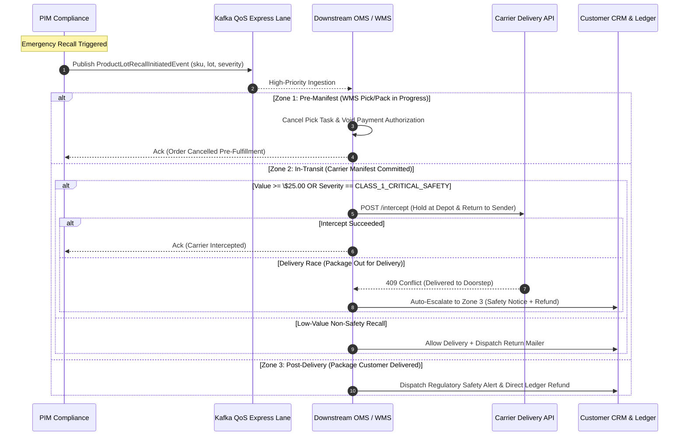
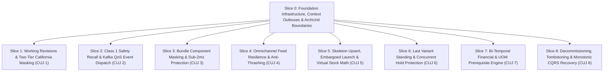

# PIM Lifecycle State Machine & Event-Driven Resilience Architecture

* **Author:** Thien An Nguyen
* **Status:** Approved
* **Date:** 2026-11-24
* **Architecture:** Modular Monolith with Hexagonal Domain Contexts & External Event-Driven Integration (Kafka KRaft)

---

## Overview

This technical design document specifies the architecture, domain models, and execution contracts for an enterprise-grade Product Information Management (PIM) platform. The system governs the lifecycle of product families, variants, digital assets, continuous regulatory compliance, and multi-channel syndication.

The platform is architected as a **Modular Monolith** organized into strictly isolated hexagonal domain contexts (`catalog-context`, `compliance-context`, `dam-context`, `taxonomy-context`, `syndication-context`, `localization-context`) sharing a single PostgreSQL cluster with logical schema separation. A central application harness (`pim-bootstrap`) boots the system, while the single deployable binary supports operational role segregation (interactive REST traffic vs. background asynchronous workers) via Spring profiles in production environments.

High-velocity warehouse stock levels and customer checkout transactions are decoupled from PIM master data using a CQRS composite edge read model hosted in Elasticsearch. The core domain implements an 8-state Guarded Finite State Machine (FSM), a Two-Tier availability model (Global Lifecycle vs. Localized Availability Masks), deterministic "Hero Variant" fallback, a Kafka QoS safety recall contract, and threshold-gated bundle cascades with sub-2ms Redis Set inverse masking for direct availability queries.

---

## The Problem

The initial system operated under a linear happy-path assumption (`DRAFT -> ENRICHED -> APPROVED -> PUBLISHED`), exhibiting five critical operational and structural failure modes:
1. **Unidirectional Dead-Ends & Silent Failures:** Variant compliance failures or loss of primary media assets either went unhandled or triggered blunt demotions of the entire product family back to `ENRICHED` without remediation context.
2. **Missing Event Choreography Links:** Initial specifications expected asynchronous events (`ProductCreated`, `ProductEnriched`, `ComplianceEvaluated`), but the catalog codebase lacked corresponding domain events and consumer listeners, stranding products in unapproved states.
3. **Omnichannel Feedback Blind Spots:** Syndication treated external marketplace feeds (Amazon SP-API) and internal mobile apps as fire-and-forget. Asynchronous feed processing rejections were not reflected in catalog availability, creating discrepancies between internal PIM state and storefront availability.
4. **Cascade Storms on Virtual Bundles:** Restricting a shared component SKU produced fan-out updates across thousands of parent bundles, risking message broker saturation and severe database lock contention.
5. **Recall Impedance Mismatch:** Emergency safety recalls lacked a prioritized messaging path to notify downstream warehouse and fulfillment systems, risking delivery of hazardous inventory to consumers.

---

## Goals

* **Goal 1: Modular Monolith Architecture with In-Process Hexagonal Contexts:** Build the PIM core as a single codebase with strictly isolated domain contexts communicating in-process via Public Application Facades and per-context Transactional Outboxes, avoiding distributed microservice network hops and serialized data transport overhead while preserving Clean Architecture boundaries.
* **Goal 2: 8-State Guarded Finite State Machine (FSM):** Replace linear progression with an 8-state variant lifecycle supporting cyclic remediation (`SKU_RESTRICTED -> SKU_IN_REVIEW -> SKU_ACTIVE`), quarantine isolation (`SKU_RECALLED_LOT_HOLD`), and permanent decommissioning (`SKU_DISCONTINUED`, `SKU_ARCHIVED`).
* **Goal 3: Two-Tier Availability Model & Dynamic Hero Promotion:** Decouple global variant viability (`SKU_ACTIVE`) from localized channel and regional restrictions (`MarketComplianceMap`, `ChannelStatusMap`). When a localized restriction masks the designated primary variant (e.g., California Prop 65), promote an eligible compliant variant to "Hero" status deterministically.
* **Goal 4: Omnichannel Feed Resilience & Anti-Thrashing:** Incorporate asynchronous feed processing feedback from external marketplaces. Enforce version-pinned evaluation (`evaluatedVersion == currentVersion`) to discard stale rejections from older catalog revisions and prevent publishing feedback thrashing.
* **Goal 5: Sub-2ms Storefront Availability Bundle Protection & Chunked Database Cascades:** When a shared component SKU is restricted, protect bundle availability instantly ($< 2\text{ ms}$) via a distributed Redis Set (`blacklisted_component_skus`) at the Storefront Availability / PDP Read API, while asynchronously updating parent bundles in PostgreSQL and Elasticsearch in bounded chunks of 250 with deterministic lock ordering (`ORDER BY id`).
* **Goal 6: PIM Safety Recall Quarantine & Event Dispatch:** When a Class 1 recall is initiated, transition the variant to `SKU_RECALLED_LOT_HOLD` and emit `ProductLotRecallInitiatedEvent` to the Kafka QoS Express Lane (`compliance.report.events.qos`) with zero database wait, allowing downstream OMS/WMS systems to execute physical warehouse pick halts and carrier delivery intercepts.
* **Goal 7: Composite Read-Model Readiness Gate & Bi-Temporal Audit:** Gate edge Elasticsearch storefront indexing across three asynchronous lifecycles: PIM (`SKU_ACTIVE`), ERP (`PriceInitialized == true`), and OMS (`StockInitialized == true`). Retain unindexed skeletons until enrichment completes, monitoring stale records via a non-destructive 30-day operational alert. Enforce bi-temporal tracking (`effective_from`, `effective_to`) on financial attributes and outer packaging dimensions for freight auditing.

---

## Non-Goals

* **Non-Goal 1: Storefront Search Execution:** Elasticsearch cluster operations, Lucene scoring, full-text tokenization, and customer search query routing are owned by the Storefront Search Service. PIM is responsible solely for projecting denormalized composite catalog documents into the edge read model.
* **Non-Goal 2: Physical Warehouse Inventory & Bin Logistics:** Real-time warehouse lot and bin tracking, warehouse management execution (WMS), cycle counting, and inventory allocations are owned by external supply chain systems. PIM tracks master data attributes and compliance flags.
* **Non-Goal 3: Transactional Order & Stock Processing in PIM:** Real-time stock reservation, shopping cart checkout, package manifest assembly, and carrier delivery intercept API execution are owned by WMS/OMS. PIM provides catalog master data and publishes recall domain events.
* **Non-Goal 4: Binary Asset Storage:** PIM and DAM aggregates store only digital asset metadata, format variants, and presigned MinIO/S3 object storage URLs. Raw binary file streams never pass through the PIM application heap.

---

## Open Questions

* **Decision: Internal Outbox Topology:** The architecture reuses the established per-schema outbox table pattern (`catalog.outbox_event`, `compliance.outbox_event`, `syndication.outbox_event`) already defined in `infra/db-init/02-enable-jsonb.sql` rather than inventing a competing global outbox schema. In-process event recovery is driven by an active 60-second sweeper task in `pim-bootstrap`.
* **Decision: Read-Model Sequence Monotonicity:** External Kafka pricing and stock streams enforce standard Monotonic Upsert (`incoming.version > lastProcessedVersion`) directly into Elasticsearch, eliminating complex embedded C++ JNI RocksDB buffers and synchronous REST snapshot recovery clients.

---

## Critical User Journeys (CUJs)

### CUJ 1: Working Revisions & Two-Tier California Masking
* **Given:** A bestselling wireless speaker (SKU-1, Red) and its alternate color (SKU-2, Blue) belong to Product Family FAM-SPK. Both variants are `SKU_ACTIVE`. SKU-1 is the designated primary "Hero Variant" (`displayPriority = 100`, `isBestseller = true`).
* **When:** California expands chemical labeling regulations under Proposition 65. The automated compliance engine identifies that SKU-1 lacks updated Prop 65 warning labels, while SKU-2 remains fully compliant.
* **Then:**
  1. The compliance engine updates SKU-1's `MarketComplianceMap["US_CA"]` to `RESTRICTED`. SKU-1 remains globally `SKU_ACTIVE`, continuing unhindered sales across the other 49 US states and international channels.
  2. The storefront projection engine detects the California regional restriction on the primary variant. For California shoppers, the system deterministically promotes compliant SKU-2 (Blue) to temporary Hero status, preserving family search ranking without revenue loss.
  3. Merchandisers remediate the Prop 65 labeling defect on a Shadow Working Revision (`SKU_IN_REVIEW`). Upon compliance approval, SKU-1 merges into the live aggregate, clearing its California mask without restricting SKU availability on compliant channels.

### CUJ 2: Class 1 Safety Recall & Kafka QoS Event Dispatch
* **Given:** Infant Formula Batch Lot #9042 of SKU-INF is distributed across 3 warehouse regional distribution centers (RDCs) and multiple in-flight customer transit shipments.
* **When:** Quality Assurance identifies bacterial contamination, declaring an emergency FDA Class 1 Safety Recall via PIM Compliance API specifying `sku = "SKU-INF"`, `lotNumber = "LOT-9042"`, and `severity = "CLASS_1_CRITICAL_SAFETY"`.
* **Then:**
  1. PIM immediately transitions SKU-INF to `SKU_RECALLED_LOT_HOLD` and publishes `ProductLotRecallInitiatedEvent` to the dedicated Kafka QoS Express Lane (`compliance.report.events.qos`) with zero database wait.
  2. Downstream OMS and WMS consumers ingest the QoS event to execute the 3-Zone Point of No Return (PONR) fulfillment contract: halting warehouse picking in Zone 1, issuing carrier delivery intercepts in Zone 2, and triggering customer safety notices and ledger refunds in Zone 3.

### CUJ 3: Component Suspension & Sub-2ms Storefront Bundle Availability Masking
* **Given:** A USB-C charging cable (SKU-CBL) is sold as an individual accessory and also bundled as a required component across 1,200 gaming console and smartphone bundles.
* **When:** Regulatory inspectors issue an immediate electrical safety stop-sale on SKU-CBL.
* **Then:**
  1. Compliance transitions SKU-CBL to `SKU_SUSPENDED` and adds `SKU-CBL` to the distributed Redis Set `blacklisted_component_skus` in $< 2\text{ ms}$.
  2. Storefront Availability and PDP Read APIs querying bundle components execute `SMISMEMBER` against `blacklisted_component_skus`. Any bundle containing SKU-CBL is masked from direct purchase sub-2ms, preventing checkout leaks before database cascades begin.
  3. The `BatchComponentCoordinator` in `catalog-context` queries `catalog.bundle_component` to identify the 1,200 parent bundles, updates their JSONB `suspended_components` and `active_suspension_reasons` in PostgreSQL in chunks of 250 with deterministic sorting (`ORDER BY id`), and syncs parent family lifecycle status if active variants drop to 0.

### CUJ 4: Omnichannel Feed Resilience & Anti-Thrashing
* **Given:** A merchandiser updates the bullet points and technical specifications of a 4K Television (SKU-TV), incrementing its version from 1 to 2. Version 1 had already been submitted to Amazon SP-API.
* **When:** While Version 2 is actively publishing, Amazon's asynchronous feed processor rejects Version 1 due to a schema validation error.
* **Then:**
  1. `syndication-context` parses the Amazon feed processing report, extracting `evaluatedVersion = 1`, `channel = "AMAZON_US"`, and error payload.
  2. The anti-thrashing validation routine in `catalog-context` compares the report version against `variant.publishedVersion` (2). Because `1 < 2`, the rejection is discarded as stale, preventing Version 1 from erroneously marking Version 2 as restricted.
  3. If Amazon rejects `evaluatedVersion = 2` with a terminal error, Syndication calls `CatalogChannelFeedbackFacade.reportRejection(...)` in-process, setting `ChannelStatusMap["AMAZON_US"]` to `RESTRICTED` while keeping the variant active on other channels.

### CUJ 5: Embargoed Launch & Skeleton Readiness Gate
* **Given:** A smartphone variant (SKU-PHN) is configured with an active embargo timestamp (`embargoUntil = 2026-12-01T00:00:00Z`). Replenishment warehouse inventory arrives before merchandising data enrichment completes.
* **When:** WMS checks in 5,000 units, emitting `OmsStockReceivedEvent`. ERP sets promotional pricing, emitting `ErpPriceUpdatedEvent`.
* **Then:**
  1. `syndication-context` consumes the stock and price events. Because PIM master data is not yet published, the projector creates an unindexed skeleton document (`readinessStatus = "UNINDEXED_SKELETON"`), capturing inventory and price without exposing the item in public search.
  2. When merchandising publishes PIM master data, the readiness gate evaluates: `PimActive == true`, `PriceInitialized == true`, and `StockInitialized == true`. The document updates to `readinessStatus = "READY_INDEXED"`.
  3. Storefront search queries filter listings via dynamic timestamp predicate (`now() >= embargoUntil`). At timestamp $T$ (`2026-12-01T00:00:00Z`), `pim-bootstrap` emits `EmbargoLiftedEvent`, invalidating edge gateway response caches and alias filters without triggering bulk document re-indexing. Unindexed skeletons remain dormant until enriched, monitored by a non-destructive 30-day stale skeleton audit alert.

### CUJ 6: "Last Variant Standing" & Concurrent Hold Protection
* **Given:** A polo shirt product family (FAM-POLO) has 3 color variants. Blue (SKU-BL) and Red (SKU-RD) are `SKU_SUSPENDED`. Small Black (SKU-SM) is the sole remaining active variant (`activeVariantCount = 1`).
* **When:** SKU-SM loses its primary digital asset or fails compliance, transitioning out of `SKU_ACTIVE`. Concurrently, Legal places an explicit trademark dispute hold on the parent family.
* **Then:**
  1. Catalog detects `activeVariantCount` dropping from 1 to 0, setting parent family status to `FAMILY_SUSPENDED` and adding `NO_ACTIVE_VARIANTS` to `activeSuspensionReasons`.
  2. Legal concurrently adds `TRADEMARK_DISPUTE` to `activeSuspensionReasons`. Due to JSONB set semantics and optimistic locking, both reasons coexist (`["NO_ACTIVE_VARIANTS", "TRADEMARK_DISPUTE"]`).
  3. When merchandisers restore SKU-SM to `SKU_ACTIVE`, `NO_ACTIVE_VARIANTS` is cleared. However, because `activeSuspensionReasons` still contains `TRADEMARK_DISPUTE`, the family remains `FAMILY_SUSPENDED`, preventing automated variant recovery from prematurely lifting an active legal hold.

### CUJ 7: Financial Temporal Audit & UOM Logistics Reconciliation
* **Given:** A beverage SKU (SKU-JCE) had its `MASTER_CARTON` dimensional weight corrected on November 1 from 12 kg to 14 kg, and its Tax Band shifted from `ESSENTIAL_GROCERIES` to `STANDARD_VAT` on November 10.
* **When:** Finance audits a carrier freight invoice dated October 25, while Accounting reconciles a customer return for an order placed on November 5.
* **Then:**
  1. Finance queries PIM financial history specifying `asOf = "2026-10-25"`. PIM returns the master carton weight active on that date (12 kg), preventing an erroneous carrier overcharge dispute.
  2. Accounting queries tax metadata specifying `asOf = "2026-11-05"`. PIM returns `ESSENTIAL_GROCERIES`, ensuring historical return credits remain consistent with the tax rate charged at checkout.

### CUJ 8: End-of-Life Tombstoning & Monotonic CQRS Read-Model Upsert
* **Given:** A consumer electronics SKU (SKU-V1) reaches end-of-life and is decommissioned.
* **When:** The aggregate transitions to `SKU_DISCONTINUED`, emitting `ProductTombstonedEvent`. Separately, an external Kafka consumer ingesting `oms.inventory.events` experiences a transient network failure, receiving event version 7 after version 5 (version 6 dropped).
* **Then:**
  1. The read-model projector consumes `ProductTombstonedEvent` and deletes the document from Elasticsearch and Redis caches, while PIM retains the soft-deleted relational record for historical warranty lookups.
  2. The external Kafka consumer evaluates monotonic sequence ordering (`incoming.version > lastProcessedVersion`). Because version 7 represents the newer state, it applies version 7 immediately and advances `lastProcessedVersion = 7`. If delayed version 6 arrives later, it is discarded as stale (`6 <= 7`).

---

## Technical Plan (Architecture)

### 1. High-Level System Architecture & Context Topology

The system is structured as an enterprise Modular Monolith organized into Hexagonal domain contexts. In-process communication occurs via strongly-typed Public Application Facades and domain events. External enterprise systems communicate strictly over Kafka KRaft.



---

### 2. The Five Mandatory Modular Monolith Guardrails

To preserve clean architectural boundaries within a single deployable binary, the platform enforces five mandatory engineering guardrails:

#### Guardrail 1: Logical Schema Isolation (Zero Cross-Schema SQL JOINs / FKs)
* PostgreSQL contains separate schemas: `catalog`, `compliance`, `dam`, `taxonomy`, `syndication`, and `localization`.
* `catalog.*` tables must not declare SQL Foreign Keys to tables in other schemas. Entities store only logical identifiers (`category_node_id UUID`, `asset_id UUID`). Enrichment data is fetched via the owning context's Public Application Facade using batch queries (e.g., `TaxonomyQueryFacade.getNodesByIds(Set<UUID>)`).

#### Guardrail 2: ArchUnit Boundary Enforcement across Hexagonal Layers
* Every domain context follows Hexagonal Architecture:
  ```text
  backend-java/<name>-context/
  ├── domain/           # Pure domain models, entities, enums (Zero framework imports)
  ├── application/      # Use cases, application services, incoming/outgoing ports, public facades
  ├── infrastructure/   # Spring Data JPA repositories, Kafka adapters, Redis clients
  └── presentation/     # REST Controllers, API DTOs
  ```
* ArchUnit tests verify at compile time:
  - `domain` depends on nothing outside its package and `shared-kernel`.
  - `shared-kernel` remains 100% pure Java (`jakarta.validation-api` only; zero Spring, JPA, or Redis dependencies).
  - External contexts may import only classes residing in `application/facades`, `application/dto`, or `domain/events` of another context. Direct access to another context's `infrastructure` or `presentation` packages triggers compilation failure.

#### Guardrail 3: Context-Level Transactional Outboxes with 60s Active Sweeper
* To prevent lost events and avoid two-phase commit overhead, each context persists outbox events into its own schema table (`catalog.outbox_event`, `compliance.outbox_event`, `syndication.outbox_event`) within the same local database transaction as aggregate mutations.
* In `pim-bootstrap`, an active reconciliation sweeper runs every 60 seconds querying uncompleted outbox records (`completed_at IS NULL AND created_at < NOW() - INTERVAL '60 SECONDS'`).
* Event completion is committed in an isolated transaction using `@Transactional(propagation = Propagation.REQUIRES_NEW)`.

#### Guardrail 4: Calibrated Database Concurrency & Lock Bounding
* High-velocity background batch updates (e.g., 1,200 parent bundle cascades) are chunked into bounded transactions of 250 items with deterministic UUID sorting (`ORDER BY id`). This constrains row-lock duration and eliminates database deadlocks.

#### Guardrail 5: Binary Media Streams Bypass JVM Heap
* Media assets uploaded to DAM are streamed directly to MinIO/S3 using client presigned upload URLs. PIM handles only metadata, format dimensions, and URL pointers.

---

### 3. Guarded Finite State Machine (FSM) Specification

#### Variant Lifecycle State Model (8 States)



* **Valid State Transitions:**
  1. `SKU_DRAFT -> SKU_IN_REVIEW`: Advances only if Base UOM (`EACH`), GTIN-12 barcode, and physical dimensions are present.
  2. `SKU_IN_REVIEW -> SKU_ACTIVE`: Requires compliance score $\ge 85\%$ and active primary media asset.
  3. `SKU_ACTIVE -> SKU_RESTRICTED`: Triggered when local availability (`MarketComplianceMap`) is masked while global aggregate remains active.
  4. `SKU_ACTIVE -> SKU_RECALLED_LOT_HOLD`: Immediate quarantine for FDA/CPSC safety recalls.
  5. `SKU_RECALLED_LOT_HOLD -> SKU_ACTIVE`: Operational bypass permitted when WMS certifies physical warehouse lot quarantine without re-authoring metadata.
  6. `SKU_RECALLED_LOT_HOLD -> SKU_DISCONTINUED`: Permanent decommission when defective products cannot be remediated.
  7. `SKU_RECALLED_LOT_HOLD -> SKU_IN_REVIEW`: Re-entry into enrichment when product reformulation or re-labeling is required.
  8. `SKU_ACTIVE -> SKU_DISCONTINUED -> SKU_ARCHIVED`: End-of-life lifecycle conclusion.

#### Family Lifecycle State Model (4 States)



* **The "Last Variant Standing" Rule:** A family remains `FAMILY_PUBLISHED` as long as at least one variant is `SKU_ACTIVE`. When the final active variant transitions out of active status, the family automatically enters `FAMILY_SUSPENDED` with suspension reason `NO_ACTIVE_VARIANTS`.

---

### 4. Data Persistence, Concurrency & Batch Coordinator Mechanics

#### Batch Coordinator Persistence & Downstream Fan-Out
When a shared component SKU is suspended, updating thousands of parent bundles requires controlled batch coordination:
1. The coordinator queries `catalog.bundle_component` to identify all parent `bundle_variant_id` values containing the affected component SKU.
2. If total bundles exceed the inline threshold (50), processing runs asynchronously in `catalog-context`, processing bounded chunks of 250 bundle IDs.
3. **Deterministic Lock Ordering:** Chunk IDs are sorted in ascending UUID order (`ORDER BY id`) prior to SQL execution to prevent cyclic deadlocks during concurrent cascades.
4. **Companion Family Synchronization:** In the same transaction, a companion SQL statement evaluates affected parent families, auto-suspending any family whose active variant count drops to 0:

```sql
-- Step 1: Batch update bundle variants with deterministic lock ordering
UPDATE catalog.product_variant
SET active_suspension_reasons = active_suspension_reasons || '{"COMPONENT_DEPENDENCY": true}'::jsonb,
    suspended_components      = suspended_components || jsonb_build_object(:componentSku, true),
    version                   = version + 1
WHERE id = ANY(:sortedChunkOf250BundleVariantIds);

-- Step 2: Auto-suspend parent families whose active variants drop to 0
UPDATE catalog.product_family pf
SET active_suspension_reasons = pf.active_suspension_reasons || '{"NO_ACTIVE_VARIANTS": true}'::jsonb,
    lifecycle_state           = 'FAMILY_SUSPENDED',
    version                   = pf.version + 1
WHERE pf.id IN (
    SELECT DISTINCT pv.family_id 
    FROM catalog.product_variant pv 
    WHERE pv.id = ANY(:sortedChunkOf250BundleVariantIds)
)
AND (
    SELECT COUNT(*) 
    FROM catalog.product_variant v 
    WHERE v.family_id = pf.id 
      AND v.lifecycle_state = 'SKU_ACTIVE'
      AND v.active_suspension_reasons = '{}'::jsonb
) = 0;
```

#### PostgreSQL JSONB Set Semantics for Concurrency Control
Administrative and compliance holds use PostgreSQL JSONB map keys as a mathematical set. Adding a reason uses `||`; removing a reason uses `-`:

```sql
-- Add hold reason
UPDATE catalog.product_family
SET active_suspension_reasons = active_suspension_reasons || jsonb_build_object(:reason, true),
    lifecycle_state = 'FAMILY_SUSPENDED',
    version = version + 1
WHERE id = :familyId AND version = :expectedVersion;

-- Remove hold reason (auto-restores FAMILY_PUBLISHED when set becomes empty)
UPDATE catalog.product_family
SET active_suspension_reasons = active_suspension_reasons - :reason,
    lifecycle_state = CASE 
        WHEN (active_suspension_reasons - :reason) = '{}'::jsonb AND :activeVariantCount > 0 
        THEN 'FAMILY_PUBLISHED' 
        ELSE lifecycle_state 
    END,
    version = version + 1
WHERE id = :familyId AND version = :expectedVersion;
```

#### Sub-2ms Storefront Availability Protection via Native Redis Set
To prevent checkout leaks during batch cascades, bundle protection is enforced at two distinct architectural boundaries:
* **Boundary A (Storefront Bundle Availability & PDP Direct Read API — Sub-2ms):** The direct availability lookup queries the distributed Redis Set `blacklisted_component_skus` via `SMISMEMBER`. If any required component SKU is present, the API immediately returns `available: false`, guaranteeing immediate protection with deterministic set membership.
* **Boundary B (Storefront Search Discovery — Eventual):** Elasticsearch catalog search indexes are updated asynchronously in bulk by `syndication-context` as the Batch Coordinator flushes chunks.
* **Cold-Start Hydration:** An `ApplicationReadyEvent` listener in `syndication-context` executes on application boot, querying PostgreSQL for all active suspended component SKUs and populating `blacklisted_component_skus` in Redis via pipeline `SADD`.

---

### 5. Omnichannel Feedback & Temporal Wall-Clock Scheduling

#### Version-Pinned Channel Rejection Loop
When external channels reject syndicated catalog feeds asynchronously:
* Syndication parses the channel feed processing report, extracting `evaluatedVersion` and `channelName`.
* Catalog evaluates version pinning:
  * If `evaluatedVersion < variant.publishedVersion`: The rejection is discarded as stale.
  * If `evaluatedVersion == variant.publishedVersion`: Catalog updates `ChannelStatusMap[channelName] = RESTRICTED` and records rejection error diagnostics.

#### Temporal Embargoes & Street Dates
* Future launches are configured with `embargoUntil` and `streetDate` timestamps.
* Search queries evaluate dynamic timestamp predicates (`now() >= embargoUntil`) to prevent premature discovery.
* At timestamp $T$, `pim-bootstrap` emits `EmbargoLiftedEvent`, invalidating edge gateway response caches and index alias filters without triggering bulk document re-indexing spikes.

---

### 6. The 3-Zone Point of No Return (PONR) Protocol (Downstream OMS Contract)

When PIM Compliance emits `ProductLotRecallInitiatedEvent` to the Kafka QoS Express Lane (`compliance.report.events.qos`), external downstream Order Management (OMS) and Warehouse (WMS) systems execute the 3-Zone fulfillment interception protocol:



---

### 7. Composite Read-Model (CQRS) & Monotonic Sequence Ordering

#### Storefront Composite Projection Schema
Downstream storefronts consume denormalized catalog documents from Elasticsearch:

```json
{
  "sku": "SKU-PHN-BLK",
  "familyId": "f47ac10b-58cc-4372-a567-0e02b2c3d479",
  "readinessStatus": "READY_INDEXED",
  "lifecycleState": "SKU_ACTIVE",
  "embargoUntil": "2026-12-01T00:00:00Z",
  "pim": {
    "title": "Pro Smartphone 256GB Black",
    "primaryImageUrl": "https://cdn.retail.com/assets/phn-blk.webp",
    "displayPriority": 100,
    "isBestseller": true,
    "lastProcessedVersion": 4
  },
  "erp": {
    "priceInitialized": true,
    "basePrice": 999.00,
    "currency": "USD",
    "lastProcessedVersion": 12
  },
  "oms": {
    "stockInitialized": true,
    "availableToPromise": 450,
    "lastProcessedVersion": 88
  }
}
```

#### Debounced Virtual Bundle ATP Projection
When high-velocity inventory events arrive for shared components, calculating $\min(\lfloor Stock_i / Qty_i \rfloor)$ across 1,200 bundles is debounced by a write accumulator in `syndication-context`, flushing derived bundle ATP updates to Elasticsearch at bounded intervals (at most once every 5 seconds per bundle) to prevent write queue saturation.

#### Consumer Monotonic Sequence Handling
External Kafka consumers ingesting pricing (`erp.pricing.events`) and stock (`oms.inventory.events`) apply Monotonic Upsert semantics:
* If `incoming.version > lastProcessedVersion`: The consumer updates the projection attributes in Elasticsearch and sets `lastProcessedVersion = incoming.version`.
* If `incoming.version <= lastProcessedVersion`: The event is discarded as stale.

#### Non-Destructive Skeleton Lifecycle
* When warehouse stock or pricing arrives before PIM master data, the projector creates an unindexed skeleton (`readinessStatus = "UNINDEXED_SKELETON"`).
* Unindexed skeletons remain dormant in Elasticsearch until `ProductPublishedEvent` completes enrichment.
* A scheduled task runs weekly generating an operational audit report of skeletons older than 30 days for human merchandising review, without destructive deletion.

---

## Risks, Failure Modes & Mitigations

### 1. High-Velocity Bundle Fan-Out Write Saturation
* **Risk:** A component SKU shared across thousands of bundles experiences frequent stock fluctuations or an emergency restriction, triggering thousands of simultaneous Elasticsearch document updates.
* **Mitigation:**
  - Database updates in `catalog-context` are split into 250-item transactions with deterministic sorting (`ORDER BY id`).
  - Elasticsearch updates in `syndication-context` are debounced via an in-memory write accumulator flusher (5-second window per bundle).
  - Immediate bundle purchasing is blocked sub-2ms at the Availability / PDP Read API via Redis Set `SMISMEMBER`.

### 2. Upstream Out-of-Order Message Arrival
* **Risk:** Network hiccups cause version 7 of an ERP price event to arrive before version 6.
* **Mitigation:** CQRS consumers apply state-replacement Monotonic Upsert. Version 7 reflects newer truth and is applied immediately; late-arriving version 6 is dropped as stale. Transient application errors trigger standard Spring Kafka `@RetryableTopic` backoff.

### 3. Redis Cluster Outage or Eviction
* **Risk:** Redis cluster restarts or evicts keys under memory pressure, wiping `blacklisted_component_skus`.
* **Mitigation:** An `ApplicationReadyEvent` listener executes on application boot, repopulating the blacklist from PostgreSQL. In addition, persistent bundle states in PostgreSQL and Elasticsearch ensure catalog discovery remains protected.

### 4. Database Connection Starvation Under Cascade Load
* **Risk:** Heavy batch cascades on `catalog.product_variant` saturate HikariCP connection pools.
* **Mitigation:** Batch processing runs asynchronously with explicit statement timeouts (3s), chunked commits of 250 items, and short transaction boundaries.

---

## Alternatives Considered

* **Alternative A: Distributed Microservices with gRPC**
  * *Decision: Rejected due to operational complexity and latency overhead.* High data cohesion between Catalog, Taxonomy, Compliance, and DAM makes a Modular Monolith with in-process facades far faster ($< 0.1\text{ ms}$ in-memory calls vs $15\text{ ms}$ network hops) and significantly simpler to test and operate.
* **Alternative B: Distributed Transactions (2PC / XA) for Virtual Bundles**
  * *Decision: Rejected due to lock contention and failure amplification.* Two-phase commit across distributed services causes severe latency and coordinator bottlenecks. The design adopts threshold-gated asynchronous batch coordination with sub-2ms Redis Set inverse masking.
* **Alternative C: Blunt Product Family Demotion on Variant Failure**
  * *Decision: Rejected due to commercial disruption.* Halting an entire multi-variant product family due to a compliance defect on a single regional SKU stops compliant sales unnecessarily. The design uses Two-Tier Availability Masks.
* **Alternative D: Synchronous HTTP Feeds for Marketplace Syndication**
  * *Decision: Rejected due to rate limiting and API latency.* Synchronous syndication blocks publishing threads. The design uses asynchronous Kafka event choreography with version-pinned feed rejection handling.
* **Alternative E: Centralized Multi-Tenant Outbox Schema (`outbox.outbox_event`)**
  * *Decision: Rejected due to Clean Architecture boundary violations.* Creating a shared outbox entity in `shared-kernel` forces JPA/Spring dependencies into a pure Java library. Reusing existing per-context `<context>.outbox_event` tables maintains strict domain isolation.
* **Alternative F: Modeling Variant Remediation as a Directed Acyclic Graph (DAG)**
  * *Decision: Rejected due to mathematical incompatibility.* A DAG cannot represent cyclic remediation flows (`SKU_ACTIVE -> SKU_RESTRICTED -> SKU_IN_REVIEW -> SKU_ACTIVE`). The design uses an 8-state Guarded FSM.
* **Alternative G: Relational Array Column (`TEXT[]`) for Active Suspension Reasons**
  * *Decision: Rejected due to lack of set semantics and duplicate entry risks.* PostgreSQL `array_append` allows duplicates. The design uses PostgreSQL JSONB maps (`active_suspension_reasons || '{"REASON": true}'::jsonb`) for mathematical set behavior.
* **Alternative H: Probabilistic Bloom Filter for Bundle Masking**
  * *Decision: Rejected due to false positives and inability to handle unmasking.* Standard Bloom filters cannot delete items on recovery and introduce false-positive purchase blocks. The design uses a native Redis Set (`SMISMEMBER`).
* **Alternative I: Physical Module Restructuring (`*-module`)**
  * *Decision: Rejected due to massive file churn and build breakage.* Renaming existing `*-context` Maven modules breaks build consistency without added value. Boundary enforcement is achieved via ArchUnit tests on hexagonal layers.
* **Alternative J: Embedded RocksDB Buffer for Gap Holding**
  * *Decision: Rejected due to accidental complexity and JNI maintenance.* Embedding C++ RocksDB in stateless Spring Boot pods creates pod-restart data loss and head-of-line blocking. The design uses Monotonic Upsert on CQRS read models.
* **Alternative K: Destructive 7-Day Skeleton Deletion with REST Snapshot Fallback**
  * *Decision: Rejected due to data loss and cross-service coupling.* Deleting unindexed skeletons destroys valid warehouse stock for SKUs taking 2–4 weeks to enrich. Skeletons remain dormant until published, monitored by a 30-day non-destructive audit report.

---

## Detailed Implementation Plan (Vertical Business Slices)

This implementation plan is organized into **1 Foundation Enabler Slice + 8 Vertical Business Slices** mapping directly 1-to-1 to CUJs 1 through 8.



---

### Slice 0: Foundation Infrastructure, Context Outboxes & ArchUnit Boundaries

* **Business Objective:** Establish core schema migrations, context-level Transactional Outbox entities, ArchUnit boundary enforcement, and Redis Set repository.
* **Target Files & Changes:**
  1. `infra/db-init/03-lifecycle-resilience.sql` (Create):
     - DDL for `catalog.variant_revision`, `catalog.bundle_component`, `catalog.financial_attribute_history`.
     - `CREATE SCHEMA IF NOT EXISTS compliance; CREATE SCHEMA IF NOT EXISTS syndication;`
     - Grant schema permissions and set `ALTER DEFAULT PRIVILEGES IN SCHEMA compliance/syndication GRANT ALL ON TABLES/SEQUENCES TO pim_user;`.
     - Alter `catalog.outbox_event` (`ADD COLUMN IF NOT EXISTS completed_at TIMESTAMPTZ, ADD COLUMN IF NOT EXISTS destination VARCHAR(50) DEFAULT 'EXTERNAL_KAFKA', ADD COLUMN IF NOT EXISTS partition_key VARCHAR(100); UPDATE catalog.outbox_event SET completed_at = processed_at WHERE completed_at IS NULL;`).
     - DDL for `compliance.outbox_event` and `syndication.outbox_event`.
     - Alter `catalog.product_family` (`ADD COLUMN IF NOT EXISTS active_suspension_reasons JSONB NOT NULL DEFAULT '{}'::jsonb`).
     - Alter `catalog.product_variant` (`ADD COLUMN IF NOT EXISTS lifecycle_state VARCHAR(50) NOT NULL DEFAULT 'SKU_DRAFT'`, `ADD COLUMN IF NOT EXISTS active_suspension_reasons JSONB NOT NULL DEFAULT '{}'::jsonb`, `ADD COLUMN IF NOT EXISTS channel_status_map JSONB NOT NULL DEFAULT '{}'::jsonb`, `ADD COLUMN IF NOT EXISTS market_compliance_map JSONB NOT NULL DEFAULT '{}'::jsonb`, `ADD COLUMN IF NOT EXISTS suspended_components JSONB NOT NULL DEFAULT '{}'::jsonb`, `ADD COLUMN IF NOT EXISTS embargo_until TIMESTAMPTZ`, `ADD COLUMN IF NOT EXISTS street_date TIMESTAMPTZ`, `ADD COLUMN IF NOT EXISTS is_bestseller BOOLEAN NOT NULL DEFAULT false`, `ADD COLUMN IF NOT EXISTS display_priority INT NOT NULL DEFAULT 0`, `ADD COLUMN IF NOT EXISTS published_version BIGINT NOT NULL DEFAULT 1`, `ADD COLUMN IF NOT EXISTS gtin VARCHAR(14)`, `ADD COLUMN IF NOT EXISTS fulfillment_mode VARCHAR(50)`).
  2. `backend-java/catalog-context/src/main/java/com/retail/pim/catalog/infrastructure/persistence/entity/CatalogOutboxEventJpaEntity.java` (Create):
     - JPA entity mapping `catalog.outbox_event` (with `completed_at`, `destination`, `partition_key`).
  3. `backend-java/compliance-context/src/main/java/com/retail/pim/compliance/infrastructure/persistence/entity/ComplianceOutboxEventJpaEntity.java` (Create):
     - JPA entity mapping `compliance.outbox_event`.
  4. `backend-java/syndication-context/src/main/java/com/retail/pim/syndication/infrastructure/persistence/entity/SyndicationOutboxEventJpaEntity.java` (Create):
     - JPA entity mapping `syndication.outbox_event`.
  5. `backend-java/compliance-context/pom.xml` (Modify):
     - Add dependency `spring-boot-starter-data-jpa` for outbox JPA entity compilation.
  6. `backend-java/syndication-context/pom.xml` (Modify):
     - Add dependencies `spring-boot-starter-data-jpa` and `spring-boot-starter-data-redis`.
  7. `backend-java/pim-bootstrap/pom.xml` (Create) & `backend-java/pom.xml` (Modify):
     - Register `pim-bootstrap` module in parent POM `<modules>`.
     - Configure `pim-bootstrap/pom.xml` with dependencies: context modules (`catalog-context`, `compliance-context`, `taxonomy-context`, `dam-context`, `localization-context`, `syndication-context`), Spring Boot starters (web, data-jpa, data-redis), Testcontainers (`postgresql`, `kafka`, `elasticsearch`), and ArchUnit (`com.tngtech.archunit:archunit-junit5`).
  8. `backend-java/pim-bootstrap/src/main/java/com/retail/pim/bootstrap/PimApplication.java` (Create):
     - Spring Boot main application entry point annotated with `@SpringBootApplication`.
  9. `backend-java/pim-bootstrap/src/main/java/com/retail/pim/bootstrap/workers/OutboxReconciliationSweeper.java` (Create):
     - Scheduled background task running every 60s querying uncompleted outbox rows across schemas (`completed_at IS NULL AND created_at < NOW() - INTERVAL '60 SECONDS'`) and re-dispatching them. Uses `@Transactional(propagation = Propagation.REQUIRES_NEW)` to record `completed_at = NOW()`.
  10. `backend-java/syndication-context/src/main/java/com/retail/pim/syndication/infrastructure/redis/RedisBlacklistRepository.java` (Create):
      - Redis Set client with methods:
        ```java
        public interface RedisBlacklistRepository {
            void blacklistComponent(String sku);
            void unblacklistComponent(String sku);
            boolean isComponentBlacklisted(String sku);
            List<Boolean> areComponentsBlacklisted(List<String> skus);
        }
        ```
  11. `backend-java/syndication-context/src/main/java/com/retail/pim/syndication/infrastructure/redis/RedisBlacklistInitializer.java` (Create):
      - `@EventListener(ApplicationReadyEvent.class)` cold-start routine: reads active suspended component SKUs from PostgreSQL and executes pipeline `SADD` to `blacklisted_component_skus`.
  12. `backend-java/pim-bootstrap/src/test/java/com/retail/pim/bootstrap/architecture/ArchUnitBoundaryTest.java` (Create):
      - ArchUnit rules asserting hexagonal context boundaries and pure Java `shared-kernel`.

---

### Slice 1: Working Revisions & Two-Tier California Masking (CUJ 1)

* **Business Objective:** Allow non-disruptive remediation of compliance defects via Shadow Working Revisions while enforcing regional availability masks without global SKU downtime.
* **Target Files & Changes:**
  1. `backend-java/catalog-context/src/main/java/com/retail/pim/catalog/domain/model/Variant.java` (Modify):
     - Add fields: `lifecycleState` (`VariantLifecycleState`), `marketComplianceMap` (`Map<String, String>`), `channelStatusMap` (`Map<String, String>`), `activeSuspensionReasons` (`Set<String>`), `suspendedComponents` (`Set<String>`), `embargoUntil` (`Instant`), `streetDate` (`Instant`), `isBestseller` (`boolean`), `displayPriority` (`int`), `publishedVersion` (`long`), `gtin` (`String`), `fulfillmentMode` (`String`).
     - Methods: `applyRegionalMask(String region, RestrictionReason reason)`, `clearRegionalMask(String region)`, `transitionTo(VariantLifecycleState newState)`.
  2. `backend-java/catalog-context/src/main/java/com/retail/pim/catalog/domain/model/ProductFamily.java` (Modify):
     - Method `resolveHeroVariant(String marketLocale)`: selects highest priority active compliant variant.
  3. `backend-java/catalog-context/src/main/java/com/retail/pim/catalog/domain/model/VariantRevision.java` (Create):
     - Aggregate for shadow editing without mutating the published variant.
  4. `backend-java/catalog-context/src/main/java/com/retail/pim/catalog/infrastructure/persistence/entity/VariantJpaEntity.java` (Modify):
     - Explicit JPA mappings: `lifecycle_state` (`@Enumerated(EnumType.STRING)`), `active_suspension_reasons` (`@Type(JsonBinaryType.class)`), `channel_status_map` (`@Type(JsonBinaryType.class)`), `market_compliance_map` (`@Type(JsonBinaryType.class)`), `suspended_components` (`@Type(JsonBinaryType.class)`), `embargo_until` (`Instant`), `street_date` (`Instant`), `is_bestseller` (`boolean`), `display_priority` (`int`), `published_version` (`long`), `gtin` (`String`), `fulfillment_mode` (`String`).
  5. `backend-java/catalog-context/src/main/java/com/retail/pim/catalog/infrastructure/persistence/entity/VariantRevisionJpaEntity.java` (Create):
     - Entity mapping `catalog.variant_revision`.
  6. `backend-java/catalog-context/src/main/java/com/retail/pim/catalog/application/services/VariantRevisionService.java` (Create):
     - `createWorkingRevision(String sku)`
     - `submitForReview(UUID revisionId)`: calls `ComplianceEvaluationFacade.validateVariantRevision(revisionId)` in-process.
     - `promoteRevision(UUID revisionId)`: merges changes, increments `publishedVersion`, and clears `marketComplianceMap["US_CA"]`.
  7. `backend-java/compliance-context/src/main/java/com/retail/pim/compliance/application/facades/ComplianceEvaluationFacade.java` (Create):
     - Public application facade for evaluating variant revision compliance.
  8. `backend-java/catalog-context/src/main/java/com/retail/pim/catalog/presentation/controllers/VariantRevisionController.java` (Create):
     - REST API:
       - `POST /api/v1/catalog/variants/{sku}/revisions` $\to$ `201 Created` (`RevisionResponseDto`)
       - `PUT /api/v1/catalog/variants/{sku}/revisions/{id}` $\to$ `200 OK` (`UpdateRevisionRequestDto`)
       - `POST /api/v1/catalog/variants/{sku}/revisions/{id}/submit` $\to$ `200 OK`
       - `POST /api/v1/catalog/variants/{sku}/revisions/{id}/promote` $\to$ `200 OK`
  9. `backend-java/catalog-context/src/main/java/com/retail/pim/catalog/domain/events/VariantPromotedEvent.java` (Create).

---

### Slice 2: Class 1 Safety Recall & Kafka QoS Event Dispatch (CUJ 2)

* **Business Objective:** Immediate variant quarantine on safety recall with zero-delay publication to Kafka QoS Express Lane for external OMS/WMS warehouse pick halts and carrier intercepts.
* **Target Files & Changes:**
  1. `backend-java/compliance-context/src/main/java/com/retail/pim/compliance/application/services/EmergencyRecallService.java` (Create):
     - Orchestrates recall: calls `CatalogRecallFacade.quarantineVariant(sku, lotNumber)` in-process, and publishes `ProductLotRecallInitiatedEvent` to Kafka QoS topic `compliance.report.events.qos`.
  2. `backend-java/catalog-context/src/main/java/com/retail/pim/catalog/application/facades/CatalogRecallFacade.java` (Create):
     - Public facade transitioning variant to `SKU_RECALLED_LOT_HOLD`.
  3. `backend-java/compliance-context/src/main/java/com/retail/pim/compliance/presentation/controllers/EmergencyRecallController.java` (Create):
     - REST API: `POST /api/v1/compliance/recalls` $\to$ `202 Accepted` (`RecallRequestDto{sku, lotNumber, severity}`).
  4. `backend-java/compliance-context/src/main/java/com/retail/pim/compliance/domain/events/ProductLotRecallInitiatedEvent.java` (Create):
     - Event payload: `sku`, `lotNumber`, `severity`, `timestamp`.

---

### Slice 3: Bundle Component Masking & Sub-2ms Protection (CUJ 3)

* **Business Objective:** Sub-2ms bundle availability masking via Redis Set, coupled with sorted chunked database fan-out cascades and parent family lifecycle synchronization.
* **Target Files & Changes:**
  1. `backend-java/catalog-context/src/main/java/com/retail/pim/catalog/domain/model/BundleComponent.java` (Create):
     - Domain entity mapping bundle component membership (`bundleVariantId`, `componentSku`, `requiredQty`).
  2. `backend-java/catalog-context/src/main/java/com/retail/pim/catalog/infrastructure/persistence/entity/BundleComponentJpaEntity.java` (Create).
  3. `backend-java/catalog-context/src/main/java/com/retail/pim/catalog/infrastructure/persistence/repository/BundleComponentRepository.java` (Create).
  4. `backend-java/catalog-context/src/main/java/com/retail/pim/catalog/application/services/BatchComponentCoordinator.java` (Create):
     - Orchestrates bundle updates: sorts chunk IDs in ascending UUID order (`ORDER BY id`). Updates variants in chunks of 250, followed by companion family sync SQL. Calls `SyndicationModuleFacade.bulkMaskBundles(chunkIds)` in-process.
  5. `backend-java/syndication-context/src/main/java/com/retail/pim/syndication/application/facades/SyndicationModuleFacade.java` (Create):
     - In-process facade for bulk Elasticsearch updates.
  6. `backend-java/syndication-context/src/main/java/com/retail/pim/syndication/presentation/controllers/StorefrontAvailabilityController.java` (Create):
     - REST API: `GET /api/v1/syndication/availability/bundles/{sku}` $\to$ `200 OK` (checks Redis `SMISMEMBER` sub-2ms).

---

### Slice 4: Omnichannel Feed Resilience & Anti-Thrashing (CUJ 4)

* **Business Objective:** Prevent feed publishing thrashing by validating feed rejection versions against published aggregate versions.
* **Target Files & Changes:**
  1. `backend-java/catalog-context/src/main/java/com/retail/pim/catalog/application/facades/CatalogChannelFeedbackFacade.java` (Create):
     - Facade exposing `reportChannelRejection(String sku, String channel, long evaluatedVersion, String errorMsg)`.
  2. `backend-java/syndication-context/src/main/java/com/retail/pim/syndication/application/services/AmazonFeedProcessingReportParser.java` (Create):
     - Parses Amazon SP-API report XML/JSON, routing HTTP 429 to exponential retry queue and terminal rejections to `CatalogChannelFeedbackFacade`.
  3. `backend-java/catalog-context/src/main/java/com/retail/pim/catalog/application/services/ChannelFeedbackService.java` (Create):
     - Anti-thrashing validation: if `evaluatedVersion < variant.publishedVersion`, discard as stale. If equal, set `channelStatusMap[channel] = RESTRICTED`.

---

### Slice 5: Skeleton Upsert, Embargoed Launch & Virtual Stock Math (CUJ 5)

* **Business Objective:** Storefront composite readiness gating across PIM, ERP, and OMS with non-destructive skeleton lifecycle and dynamic embargo unmasking.
* **Target Files & Changes:**
  1. `backend-java/syndication-context/src/main/java/com/retail/pim/syndication/application/projections/ProductReadModelProjector.java` (Modify):
     - `@KafkaListener` handlers for `oms.inventory.events`, `erp.pricing.events`, and `catalog.product.events`.
     - Creates unindexed skeleton if PIM master data is missing. Updates to `READY_INDEXED` when all three lifecycles are initialized.
     - Debounced virtual bundle ATP accumulator (flushes max once every 5 seconds per bundle).
  2. `backend-java/pim-bootstrap/src/main/java/com/retail/pim/bootstrap/schedulers/TemporalEmbargoScheduler.java` (Create):
     - Scheduled poller emitting `EmbargoLiftedEvent` at timestamp $T$.
  3. `backend-java/pim-bootstrap/src/main/java/com/retail/pim/bootstrap/workers/StaleSkeletonAuditReporter.java` (Create):
     - Non-destructive weekly audit reporting unindexed skeletons older than 30 days.

---

### Slice 6: Last Variant Standing & Concurrent Hold Protection (CUJ 6)

* **Business Objective:** Automated parent family suspension when active variants drop to 0, with concurrent JSONB set hold coexistence.
* **Target Files & Changes:**
  1. `backend-java/catalog-context/src/main/java/com/retail/pim/catalog/domain/enums/VariantLifecycleState.java` (Create): 8 states.
  2. `backend-java/catalog-context/src/main/java/com/retail/pim/catalog/domain/enums/FamilyLifecycleState.java` (Create): 4 states.
  3. `backend-java/catalog-context/src/main/java/com/retail/pim/catalog/application/services/VariantStateManagementService.java` (Create):
     - Evaluates `activeVariantCount` on variant transition. Triggers family hold if count reaches 0.
  4. `backend-java/catalog-context/src/main/java/com/retail/pim/catalog/application/services/FamilyHoldManagementService.java` (Create):
     - Applies and lifts holds using JSONB `||` and `-` operations with `@Version` optimistic concurrency checks.
  5. `backend-java/catalog-context/src/main/java/com/retail/pim/catalog/presentation/controllers/AdministrativeHoldController.java` (Create):
     - REST API:
       - `POST /api/v1/catalog/families/{id}/holds` $\to$ `200 OK` (`HoldRequestDto{reason}`, `If-Match` version header)
       - `DELETE /api/v1/catalog/families/{id}/holds/{reason}` $\to$ `200 OK`
  6. `backend-java/catalog-context/src/main/java/com/retail/pim/catalog/domain/model/ProductFamily.java` (Modify):
     - Add fields: `activeSuspensionReasons` (`Set<String>`), `lifecycleState` (`FamilyLifecycleState`).
     - Methods: `applyHold(String reason, String expectedVersion)`, `liftHold(String reason, String expectedVersion)`, `evaluateVariantCount(int activeCount)`.
  7. `backend-java/catalog-context/src/main/java/com/retail/pim/catalog/infrastructure/persistence/entity/ProductJpaEntity.java` (Modify):
     - Map `active_suspension_reasons` JSONB column and `FamilyLifecycleState` enum on the family JPA entity.
  8. `backend-java/catalog-context/src/main/java/com/retail/pim/catalog/domain/enums/ProductLifecycleState.java` (Modify):
     - Deprecate/delegate legacy linear states in favor of `FamilyLifecycleState` and `VariantLifecycleState`.

---

### Slice 7: Bi-Temporal Financial & UOM Prerequisite Engine (CUJ 7)

* **Business Objective:** Bi-temporal audit tracking of dimensions, tax bands, and customs codes with historical `asOf` snapshot queries and UOM prerequisites.
* **Target Files & Changes:**
  1. `backend-java/catalog-context/src/main/java/com/retail/pim/catalog/domain/model/FinancialAttributeHistory.java` (Create).
  2. `backend-java/catalog-context/src/main/java/com/retail/pim/catalog/infrastructure/persistence/entity/FinancialAttributeHistoryJpaEntity.java` (Create).
  3. `backend-java/catalog-context/src/main/java/com/retail/pim/catalog/infrastructure/persistence/repository/FinancialAttributeHistoryRepository.java` (Create).
  4. `backend-java/catalog-context/src/main/java/com/retail/pim/catalog/application/compliance/UomPrerequisiteValidator.java` (Create):
     - Validates Base UOM (`EACH`), GTIN-12 barcode, and physical dimensions prior to `SKU_ACTIVE`.
  5. `backend-java/catalog-context/src/main/java/com/retail/pim/catalog/application/services/FinancialMasterDataService.java` (Create):
     - Bi-temporal close-and-insert logic (`effective_to = NOW()`).
     - `getHistoricalSnapshot(sku, uomTier, asOfTimestamp)`.
  6. `backend-java/catalog-context/src/main/java/com/retail/pim/catalog/presentation/controllers/FinancialMasterDataController.java` (Create):
     - REST API:
       - `GET /api/v1/catalog/skus/{sku}/financials?asOf={timestamp}&uomTier={tier}` $\to$ `200 OK`
       - `PUT /api/v1/catalog/skus/{sku}/financials` $\to$ `200 OK` (`FinancialAttributesDto`)

---

### Slice 8: Decommissioning, Tombstoning & Monotonic CQRS Recovery (CUJ 8)

* **Business Objective:** Storefront document purging via tombstone events, lot-recall quarantine exit bypass, and Monotonic Upsert on external Kafka streams.
* **Target Files & Changes:**
  1. `backend-java/catalog-context/src/main/java/com/retail/pim/catalog/application/services/VariantDecommissionService.java` (Create):
     - Transitions variant to `SKU_DISCONTINUED` or `SKU_ARCHIVED`. Publishes `ProductTombstonedEvent`.
  2. `backend-java/catalog-context/src/main/java/com/retail/pim/catalog/application/facades/CatalogQuarantineFacade.java` (Create):
     - Exposes `certifyLotQuarantine(sku, lotNumber)`: transitions variant directly from `SKU_RECALLED_LOT_HOLD` back to `SKU_ACTIVE` upon WMS physical warehouse quarantine certification.
  3. `backend-java/syndication-context/src/main/java/com/retail/pim/syndication/application/messaging/ExternalMonotonicSequenceProjector.java` (Create):
     - Active on Kafka consumers (`erp.pricing.events`, `oms.inventory.events`):
       - If `version > lastProcessed`: Updates Elasticsearch attributes and advances `lastProcessedVersion = version`.
       - If `version <= lastProcessed`: Discards event as stale.
  4. `backend-java/catalog-context/src/main/java/com/retail/pim/catalog/domain/events/ProductTombstonedEvent.java` (Create).

---

### Verification Plan

#### 1. Compilation & Architecture Enforcement
* **Command:**
  ```bash
  mvn clean test-compile && mvn test -Dtest=ArchUnitBoundaryTest
  ```
* **Success Criteria:** Zero compilation errors. ArchUnit tests confirm zero unauthorized cross-context imports and 100% pure Java `shared-kernel`.

#### 2. Unit Test Suite
* `backend-java/catalog-context/src/test/java/com/retail/pim/catalog/domain/model/VariantRevisionTest.java`: Verifies working copy attribute isolation and promotion.
* `backend-java/catalog-context/src/test/java/com/retail/pim/catalog/domain/model/ProductFamilyStateMachineTest.java`: Verifies all 8 variant states, exit transitions from `SKU_RECALLED_LOT_HOLD`, and "Last Variant Standing" rules.
* `backend-java/catalog-context/src/test/java/com/retail/pim/catalog/infrastructure/persistence/SuspensionSetConcurrencyTest.java`: Verifies PostgreSQL JSONB set operations (`||` and `-`) under simulated concurrent threads.
* `backend-java/catalog-context/src/test/java/com/retail/pim/catalog/application/compliance/UomPrerequisiteValidatorTest.java`: Asserts transition to `SKU_ACTIVE` fails if Base UOM (`EACH`) or GTIN barcode is missing.

#### 3. Unified Integration Test Suite (Testcontainers)
Shared test infrastructure: `backend-java/pim-bootstrap/src/test/java/com/retail/pim/bootstrap/integration/AbstractIntegrationTestBase.java` (Create) booting PostgreSQL, Kafka KRaft, Redis, and Elasticsearch containers.
* `backend-java/pim-bootstrap/src/test/java/com/retail/pim/bootstrap/integration/BundleRedisMaskingTest.java` (Create): Adds component SKU via `SADD`; verifies storefront availability API masks 1,200 bundles within $< 2\text{ ms}$.
* `backend-java/pim-bootstrap/src/test/java/com/retail/pim/bootstrap/integration/BatchCoordinatorChunkingTest.java` (Create): Cascades across 600 parent bundles; asserts exactly 3 transactions (250, 250, 100) with sorted IDs (`ORDER BY id`) and parent family status synchronization.
* `backend-java/pim-bootstrap/src/test/java/com/retail/pim/bootstrap/integration/ChannelFeedbackAntiThrashingTest.java` (Create): Publishes version 2; feeds version 1 rejection; asserts rejection is discarded as stale.
* `backend-java/pim-bootstrap/src/test/java/com/retail/pim/bootstrap/integration/RecallQosDispatchTest.java` (Create): Triggers safety recall; asserts `ProductLotRecallInitiatedEvent` is emitted to Kafka QoS Express Lane with zero delay.
* `backend-java/pim-bootstrap/src/test/java/com/retail/pim/bootstrap/integration/CqrsMonotonicUpsertTest.java` (Create): Ingests version 7 followed by version 6; verifies version 7 is applied and version 6 is dropped as stale.
* `backend-java/pim-bootstrap/src/test/java/com/retail/pim/bootstrap/integration/FinancialBiTemporalAuditTest.java` (Create): Updates `MASTER_CARTON` dimensions; executes historical query specifying `asOf`; asserts historical values active on that date are returned.
* `backend-java/pim-bootstrap/src/test/java/com/retail/pim/bootstrap/integration/ProductTombstoningTest.java` (Create): Decommissions SKU; verifies Elasticsearch document is evicted while PIM relational master record is preserved.

---

## Appendix: Persistence DDL (Multi-Schema PostgreSQL)

```sql
-- Schema Initializations
CREATE SCHEMA IF NOT EXISTS catalog;
CREATE SCHEMA IF NOT EXISTS compliance;
CREATE SCHEMA IF NOT EXISTS taxonomy;
CREATE SCHEMA IF NOT EXISTS dam;
CREATE SCHEMA IF NOT EXISTS syndication;
CREATE SCHEMA IF NOT EXISTS localization;

GRANT ALL ON SCHEMA catalog TO pim_user;
GRANT ALL ON SCHEMA compliance TO pim_user;
GRANT ALL ON SCHEMA taxonomy TO pim_user;
GRANT ALL ON SCHEMA dam TO pim_user;
GRANT ALL ON SCHEMA syndication TO pim_user;
GRANT ALL ON SCHEMA localization TO pim_user;

ALTER DEFAULT PRIVILEGES IN SCHEMA catalog GRANT ALL ON TABLES TO pim_user;
ALTER DEFAULT PRIVILEGES IN SCHEMA catalog GRANT ALL ON SEQUENCES TO pim_user;
ALTER DEFAULT PRIVILEGES IN SCHEMA compliance GRANT ALL ON TABLES TO pim_user;
ALTER DEFAULT PRIVILEGES IN SCHEMA compliance GRANT ALL ON SEQUENCES TO pim_user;
ALTER DEFAULT PRIVILEGES IN SCHEMA taxonomy GRANT ALL ON TABLES TO pim_user;
ALTER DEFAULT PRIVILEGES IN SCHEMA taxonomy GRANT ALL ON SEQUENCES TO pim_user;
ALTER DEFAULT PRIVILEGES IN SCHEMA dam GRANT ALL ON TABLES TO pim_user;
ALTER DEFAULT PRIVILEGES IN SCHEMA dam GRANT ALL ON SEQUENCES TO pim_user;
ALTER DEFAULT PRIVILEGES IN SCHEMA syndication GRANT ALL ON TABLES TO pim_user;
ALTER DEFAULT PRIVILEGES IN SCHEMA syndication GRANT ALL ON SEQUENCES TO pim_user;
ALTER DEFAULT PRIVILEGES IN SCHEMA localization GRANT ALL ON TABLES TO pim_user;
ALTER DEFAULT PRIVILEGES IN SCHEMA localization GRANT ALL ON SEQUENCES TO pim_user;

-- Core Aggregate Alterations
ALTER TABLE catalog.product_family
    ADD COLUMN IF NOT EXISTS active_suspension_reasons JSONB NOT NULL DEFAULT '{}'::jsonb;

ALTER TABLE catalog.product_variant
    ADD COLUMN IF NOT EXISTS lifecycle_state VARCHAR(50) NOT NULL DEFAULT 'SKU_DRAFT',
    ADD COLUMN IF NOT EXISTS active_suspension_reasons JSONB NOT NULL DEFAULT '{}'::jsonb,
    ADD COLUMN IF NOT EXISTS channel_status_map JSONB NOT NULL DEFAULT '{}'::jsonb,
    ADD COLUMN IF NOT EXISTS market_compliance_map JSONB NOT NULL DEFAULT '{}'::jsonb,
    ADD COLUMN IF NOT EXISTS suspended_components JSONB NOT NULL DEFAULT '{}'::jsonb,
    ADD COLUMN IF NOT EXISTS embargo_until TIMESTAMPTZ,
    ADD COLUMN IF NOT EXISTS street_date TIMESTAMPTZ,
    ADD COLUMN IF NOT EXISTS is_bestseller BOOLEAN NOT NULL DEFAULT false,
    ADD COLUMN IF NOT EXISTS display_priority INT NOT NULL DEFAULT 0,
    ADD COLUMN IF NOT EXISTS published_version BIGINT NOT NULL DEFAULT 1,
    ADD COLUMN IF NOT EXISTS gtin VARCHAR(14),
    ADD COLUMN IF NOT EXISTS fulfillment_mode VARCHAR(50);

-- Context Transactional Outbox Alteration (Catalog)
ALTER TABLE catalog.outbox_event
    ADD COLUMN IF NOT EXISTS completed_at TIMESTAMPTZ,
    ADD COLUMN IF NOT EXISTS destination VARCHAR(50) DEFAULT 'EXTERNAL_KAFKA',
    ADD COLUMN IF NOT EXISTS partition_key VARCHAR(100);
UPDATE catalog.outbox_event SET completed_at = processed_at WHERE completed_at IS NULL AND processed_at IS NOT NULL;
CREATE INDEX IF NOT EXISTS idx_catalog_outbox_unprocessed ON catalog.outbox_event (created_at) WHERE completed_at IS NULL;

-- Shadow Working Revisions
CREATE TABLE IF NOT EXISTS catalog.variant_revision (
    id UUID PRIMARY KEY DEFAULT gen_random_uuid(),
    variant_id UUID NOT NULL REFERENCES catalog.product_variant(id) ON DELETE CASCADE,
    base_version BIGINT NOT NULL,
    revision_state VARCHAR(50) NOT NULL,
    remediated_attributes JSONB NOT NULL DEFAULT '{}'::jsonb,
    created_at TIMESTAMPTZ NOT NULL DEFAULT NOW(),
    updated_at TIMESTAMPTZ NOT NULL DEFAULT NOW()
);

-- Virtual Bundle Components Join Table
CREATE TABLE IF NOT EXISTS catalog.bundle_component (
    id UUID PRIMARY KEY DEFAULT gen_random_uuid(),
    bundle_variant_id UUID NOT NULL REFERENCES catalog.product_variant(id) ON DELETE CASCADE,
    component_sku VARCHAR(100) NOT NULL,
    required_qty INT NOT NULL CHECK (required_qty > 0),
    created_at TIMESTAMPTZ NOT NULL DEFAULT NOW(),
    CONSTRAINT uq_bundle_component UNIQUE(bundle_variant_id, component_sku)
);
CREATE INDEX IF NOT EXISTS idx_bundle_component_sku ON catalog.bundle_component(component_sku);

-- Bi-Temporal Financial & Logistics Attribute History
CREATE TABLE IF NOT EXISTS catalog.financial_attribute_history (
    id UUID PRIMARY KEY DEFAULT gen_random_uuid(),
    sku VARCHAR(100) NOT NULL,
    uom_tier VARCHAR(50) NOT NULL,
    length_cm NUMERIC(10, 2) NOT NULL,
    width_cm NUMERIC(10, 2) NOT NULL,
    height_cm NUMERIC(10, 2) NOT NULL,
    gross_weight_kg NUMERIC(10, 3) NOT NULL,
    tax_band VARCHAR(50) NOT NULL,
    customs_hsn_code VARCHAR(50) NOT NULL,
    effective_from TIMESTAMPTZ NOT NULL,
    effective_to TIMESTAMPTZ NOT NULL DEFAULT 'infinity',
    created_at TIMESTAMPTZ NOT NULL DEFAULT NOW()
);
CREATE INDEX IF NOT EXISTS idx_financial_temporal ON catalog.financial_attribute_history (sku, uom_tier, effective_from, effective_to);

-- Context Transactional Outbox Tables
CREATE TABLE IF NOT EXISTS compliance.outbox_event (
    id UUID PRIMARY KEY DEFAULT gen_random_uuid(),
    event_type VARCHAR(100) NOT NULL,
    payload JSONB NOT NULL,
    destination VARCHAR(50) NOT NULL,
    partition_key VARCHAR(100),
    created_at TIMESTAMPTZ NOT NULL DEFAULT NOW(),
    completed_at TIMESTAMPTZ
);
CREATE INDEX IF NOT EXISTS idx_compliance_outbox_unprocessed ON compliance.outbox_event (created_at) WHERE completed_at IS NULL;

CREATE TABLE IF NOT EXISTS syndication.outbox_event (
    id UUID PRIMARY KEY DEFAULT gen_random_uuid(),
    event_type VARCHAR(100) NOT NULL,
    payload JSONB NOT NULL,
    destination VARCHAR(50) NOT NULL,
    partition_key VARCHAR(100),
    created_at TIMESTAMPTZ NOT NULL DEFAULT NOW(),
    completed_at TIMESTAMPTZ
);
CREATE INDEX IF NOT EXISTS idx_syndication_outbox_unprocessed ON syndication.outbox_event (created_at) WHERE completed_at IS NULL;
```
