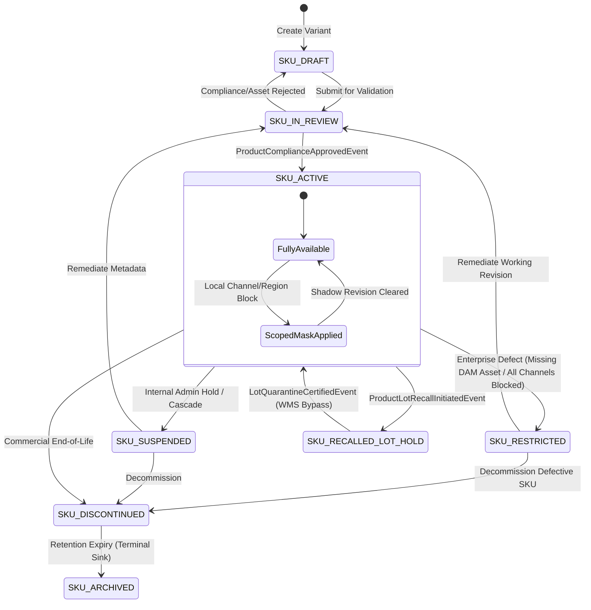
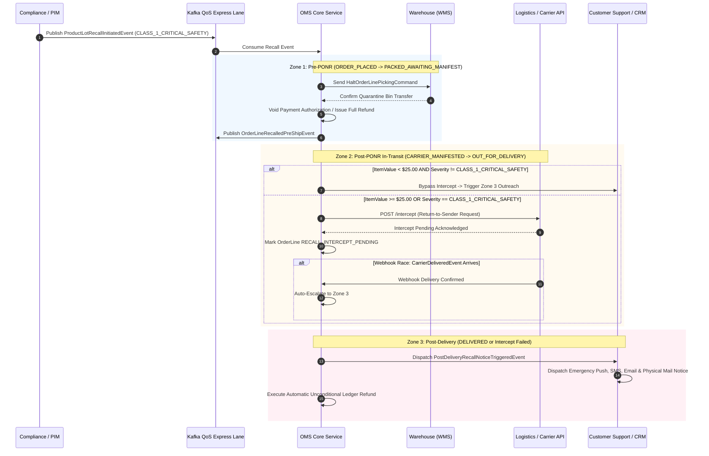

# PIM Lifecycle State Machine & Event-Driven Resilience Architecture

* **Author:** Thien An Nguyen
* **Status:** Draft
* **Date:** 2026-11-17

--------------------------------------------------------------------------------

## Overview

This technical design document specifies the architecture, domain models, and event-driven choreography required to implement a production-grade Product Information Management (PIM) platform. The system governs the lifecycle of product families, variants, media assets, dynamic compliance scoring, and multi-channel syndication.

The design decouples high-velocity warehouse stock levels and customer checkout transactions from PIM master data using CQRS and Event Sourcing composite edge read models. It establishes an 8-state Guarded Finite State Machine (FSM), a Two-Tier availability model (Global Lifecycle vs. Localized Availability Masks), deterministic "Hero Variant" fallback, a 3-Zone Point of No Return (PONR) recall contract, and threshold-gated bundle cascades with instant Redis Set inverse masking.

---

## The Problem

The existing system operates on a linear happy-path assumption (`DRAFT -> ENRICHED -> APPROVED -> PUBLISHED`), exhibiting several critical operational and structural failure modes:
1. **Unidirectional Dead-Ends & Silent Failures:** When a variant fails compliance or loses primary media assets, the core aggregate either ignores the failure or bluntly drops the entire product family back to `ENRICHED` without tracking remediation context.
2. **Missing Event Choreography Links:** Sequence specifications expect `ProductCreated`, `ProductEnriched`, and `ComplianceEvaluated`, but `catalog-context` lacks corresponding domain events and consumer listeners, stranding products in unapproved states.
3. **Omnichannel Feedback Blind Spots:** Syndication treats external marketplace feeds (e.g., Amazon SP-API) and internal mobile apps as fire-and-forget. Asynchronous feed processing rejections are not fed back into catalog availability, causing discrepancies between internal PIM state and storefront availability.
4. **Cascade Storms on Virtual Bundles:** When a shared component SKU is restricted, fan-out updates to thousands of parent bundles risk crashing message brokers and causing database table lock contention.
5. **Recall Impedance Mismatch:** Safety recalls either fail to stop in-flight warehouse orders or indiscriminately shut down uncontaminated inventory nationwide.

---

## Goals

* **Goal 1: 8-State Guarded Finite State Machine:** Enforce formal state transitions across `SKU_DRAFT`, `SKU_IN_REVIEW`, `SKU_ACTIVE`, `SKU_RESTRICTED`, `SKU_SUSPENDED`, `SKU_RECALLED_LOT_HOLD`, `SKU_DISCONTINUED`, and `SKU_ARCHIVED`.
* **Goal 2: Two-Tier Scoped Availability Engine:** Decouple global SKU viability from localized channel and regional compliance masks (`ChannelStatusMap[channelId]`, `MarketComplianceMap[marketCode]`), allowing localized remediation on shadow working revisions without taking down healthy channels.
* **Goal 3: Invariant Protection & Asymmetric Recovery:** Implement the "Last Variant Standing" rule and bundle upward cascades gated by `activeSuspensionReasons: Set<SuspensionReason>` and `suspendedComponents: Set<SkuId>`, protected by JPA `@Version` optimistic locking and target-keyed partition routing (`partitionKey = targetFamilyOrBundleId`).
* **Goal 4: 0ms Bundle Protection & Threshold-Gated Fan-Out:** Implement instant storefront bundle masking via a distributed Redis Set (`blacklisted_component_skus` via `SMISMEMBER`), paired with bounded batch persistence (threshold = 50 bundles, chunk size = 250 SKU IDs per transaction/message).
* **Goal 5: 3-Zone Line-Item PONR Recall Contract:** Intercept in-flight orders at the `FulfillmentPackage` / `OrderLine` level across Zone 1 (Pre-PONR warehouse cancellation), Zone 2 (Post-PONR carrier intercept with a `$25.00` value floor and `CLASS_1_CRITICAL_SAFETY` override), and Zone 3 (Post-Delivery regulatory outreach).
* **Goal 6: Composite Edge Read-Model Readiness Gate:** Project unified storefront documents (Elasticsearch / Redis) that remain dormant until PIM (`SKU_ACTIVE`), ERP (`PriceInitialized`), and OMS (`StockInitialized`) confirm readiness, supporting zero-price promotional items, derived bundle stock, and scheduled 7-day skeleton eviction.
* **Goal 7: Temporal Financial Master Data:** Expose event-sourced financial and logistics attributes (Tax Bands, HS Tariff Codes, Category Nodes, 4-tier UOM Packaging Dimensions) with `effectiveFrom` / `effectiveTo` timestamps.

---

## Non-Goals

* **Non-Goal 1: Physical Warehouse Lot/Bin Tracking in PIM:** PIM operates strictly at the SKU abstraction. Physical lot tracking, bin coordinates, and expiry dates belong exclusively to WMS/OMS.
* **Non-Goal 2: Transactional Order & Stock Processing in PIM:** Real-time stock reservation, shopping cart checkout, and warehouse fulfillment are owned by WMS/OMS.
* **Non-Goal 3: General Ledger & Accounts Payable Accounting in PIM:** Double-entry bookkeeping, COGS calculations, and tax ledger filings belong to ERP/Finance.
* **Non-Goal 4: Python AI Re-enrichment Loop Controls:** Throttling, causation tracking (`actorType: AI_AGENT`), and AI feedback loop guards are explicitly deferred as saved work for the Python AI agent integration phase.
* **Non-Goal 5: Distributed Saga Coordinator Engine:** Implementation of an external temporal saga coordinator is deferred to the subsequent event governance phase.

---

## Open Questions

* **Question 1:** Should carrier delivery interception API failures in Zone 2 trigger a human customer service exception task in addition to automated Zone 3 escalation?
* **Question 2:** Will first-party supermarket mobile apps ingest price and stock from the Composite Edge Read-Model directly, or will they maintain local SQLite client caches?

---

## Critical User Journeys (CUJs)

### CUJ 1: Variant Regional Restriction & Localized Hero Fallback
* **Given:** A `ProductFamily` ("Ultra Running Shoe") is `FAMILY_PUBLISHED` with three variants: Red (SKU-1, Canonical Hero), Blue (SKU-2), and Black (SKU-3).
* **When:** SKU-1 fails an ingredient compliance check in California (Prop 65), emitting `VariantRestrictedEvent`.
* **Then:** 
  1. SKU-1 remains globally `SKU_ACTIVE`, but mutates its scoped mask `MarketComplianceMap["US_CA"] = RESTRICTED`.
  2. For California shoppers, the edge projection executes a localized Hero fallback, promoting Blue (SKU-2) as the display thumbnail. For all other states and international markets, SKU-1 remains the live Hero variant.
  3. Merchandisers remediate the Prop 65 labeling defect on a Shadow Working Revision (`SKU_IN_REVIEW`). Upon compliance re-approval, SKU-1 clears its California mask without causing downtime on healthy storefronts.

### CUJ 2: Emergency Class 1 Lot Recall & 3-Zone Line-Item Order Interception
* **Given:** A baby formula SKU (SKU-BF1) has active in-flight customer orders across multiple fulfillment stages, and unaffected lots exist in western distribution centers.
* **When:** A `ProductLotRecallInitiatedEvent` is published with `recallSeverity = CLASS_1_CRITICAL_SAFETY` targeting contaminated Lot #405.
* **Then:**
  1. WMS immediately locks physical allocation against Lot #405; OMS decrements available inventory.
  2. Order A (Pre-PONR, in picking) executes `OrderLineRecalledPreShipEvent`: warehouse pick halts, units route to quarantine, and the customer payment authorization is voided.
  3. Order B (Post-PONR, shipped on carrier truck, unit price $18.00) bypasses the `$25.00` value floor due to `CLASS_1_CRITICAL_SAFETY`, emitting `CarrierDeliveryInterceptRequestedEvent` to return the parcel to depot.
  4. If Order B receives `CarrierDeliveredEvent` prior to intercept completion, the state machine auto-escalates to Zone 3, emitting `PostDeliveryRecallNoticeTriggeredEvent` to dispatch urgent safety instructions and a full refund.

### CUJ 3: Component SKU Failure & Instant 0ms Bundle Storefront Masking
* **Given:** A power cable (SKU-CBL) is used as a component in 1,200 distinct computer workstation and gaming bundles.
* **When:** SKU-CBL experiences an electrical safety suspension, transitioning to `SKU_SUSPENDED`.
* **Then:**
  1. SKU-CBL is immediately written to the distributed Redis Set `blacklisted_component_skus` via `SADD`. Storefront edge projectors check `SMISMEMBER`, instantly masking all 1,200 bundles from customer purchase within 0ms.
  2. The event router detects bundle count ($1,200 > 50$) and routes the cascade to the Batch Component Dependency Coordinator.
  3. The coordinator paginates database updates directly in PostgreSQL in chunks of 250 parent bundles per transaction (`WHERE version = :expectedVersion`), emitting chunked `BatchComponentDependencySuspendedEvent` payloads until all 1,200 records reflect `COMPONENT_DEPENDENCY` in their `activeSuspensionReasons`.
  4. When SKU-CBL is certified compliant and re-activated, `SREM` evicts it from the Redis Set, and the batch coordinator clears `COMPONENT_DEPENDENCY` across all 1,200 parent bundles.

### CUJ 4: Omnichannel Asynchronous Rejection & Anti-Thrashing
* **Given:** A variant is published at `publishedVersion = 1` and syndicated to Amazon SP-API. Merchandisers immediately update marketing copy to `publishedVersion = 2`.
* **When:** Amazon SP-API returns an asynchronous feed processing report rejecting `evaluatedVersion = 1` due to an invalid UPC format.
* **Then:**
  1. `syndication-context` inspects the version tag: since `evaluatedVersion (1) < publishedVersion (2)`, the rejection is recognized as stale and discarded without mutating catalog state.
  2. If Amazon returns an HTTP 429 Too Many Requests, it is classified as a transient infrastructure error and routed to an exponential retry queue with jitter.
  3. If Amazon rejects `evaluatedVersion = 2` with a terminal schema error, `ChannelStatusMap["AMAZON_US"]` is flipped to `RESTRICTED`, keeping the SKU active on Walmart and the in-house supermarket app.

### CUJ 5: Embargoed Launch & Skeleton Readiness Gate
* **Given:** A flagship smartphone (SKU-PHN) is staged for a secret global launch, and warehouse replenishment shipments arrive before PIM authoring completes.
* **When:** OMS publishes `StockReceivedEvent` (5,000 units), followed by ERP publishing `PriceInitializedEvent` ($0.00 promotional gift with purchase, `allowZeroPricePromo = true`), followed by PIM publishing `ProductPublished` with `embargoUntil = "2026-12-01T00:00:00Z"`.
* **Then:**
  1. OMS arrival creates a dormant skeleton document in Elasticsearch (`readinessStatus = "UNINDEXED_SKELETON"`).
  2. ERP arrival passes the price gate via `allowZeroPricePromo = true`.
  3. PIM arrival enriches the skeleton with title and media. Because `now() < embargoUntil`, the document is pre-warmed in edge search clusters in a hidden state.
  4. If any un-enriched skeleton lingers without PIM master data for 48 hours, an aggregated `OrphanedSkeletonMismatchAlert` alerts catalog operations. Skeletons un-enriched after 7 days are evicted by an automated `delete_by_query` purge.
  5. At exactly midnight on December 1, a scheduled timer emits `EmbargoLiftedEvent`, instantly making the listing searchable across global storefronts without cluster re-indexing.

### CUJ 6: "Last Variant Standing" & Concurrent Legal Hold Protection
* **Given:** A clothing family ("Classic Denim Jacket") has only one remaining active variant: Small (SKU-SM).
* **When:** SKU-SM runs out of stock or loses its primary image, transitioning out of active status (`activeVariantCount: 1 -> 0`). Concurrently, Legal files a trademark dispute against the brand name.
* **Then:**
  1. The aggregate root detects `activeVariantCount == 0`, transitions to `FAMILY_SUSPENDED`, and inserts `NO_ACTIVE_VARIANTS` into `activeSuspensionReasons`.
  2. Legal concurrently adds `TRADEMARK_DISPUTE` to `activeSuspensionReasons`. Due to JSONB set semantics and `@Version` optimistic locking, both reasons coexist (`["NO_ACTIVE_VARIANTS", "TRADEMARK_DISPUTE"]`).
  3. When merchandisers fix the image on SKU-SM and restore it to `SKU_ACTIVE`, `NO_ACTIVE_VARIANTS` is removed from the set. However, because `activeSuspensionReasons` still contains `TRADEMARK_DISPUTE`, the family remains `FAMILY_SUSPENDED`, preventing automated variant recovery from prematurely clearing an active legal hold.

### CUJ 7: Financial Temporal Audit & UOM Logistics Reconciliation
* **Given:** A beverage SKU (SKU-JCE) had its `MASTER_CARTON` dimensional weight corrected on November 1 from 12 kg to 14 kg, and its Tax Band shifted from `ESSENTIAL_GROCERIES` to `STANDARD_VAT` on November 10.
* **When:** Finance audits a carrier freight invoice dated October 25, while Accounting reconciles a customer return for an order placed on November 5.
* **Then:**
  1. Finance queries PIM financial history specifying `asOf = "2026-10-25"`. PIM returns the master carton weight active on that date (12 kg), preventing an erroneous carrier overcharge dispute.
  2. Accounting queries tax metadata specifying `asOf = "2026-11-05"`. PIM returns `ESSENTIAL_GROCERIES`, ensuring historical tax filings and return credits remain mathematically consistent with the tax rate charged at checkout.

### CUJ 8: End-of-Life Tombstoning & Out-of-Order Gap Recovery
* **Given:** A consumer electronics SKU (SKU-V1) reaches end-of-life and is decommissioned.
* **When:** The aggregate transitions to `SKU_DISCONTINUED`, emitting `ProductTombstonedEvent`. Separately, a downstream analytics consumer experiences a broker network hiccup, receiving event version 7 after version 5 (version 6 dropped).
* **Then:**
  1. The read-model projector consumes `ProductTombstonedEvent` and deletes the document from Elasticsearch and Redis storefront caches, while PIM retains the soft-deleted master record for historical warranty lookups.
  2. The analytics consumer detects the gap (`7 > 5 + 1`), buffers event 7 in a RocksDB hold queue, and starts a jittered 15-second timer.
  3. Upon timer expiry without event 6, the consumer triggers a rate-limited REST snapshot fetch against PIM, sets its local sequence pointer to 7, and resumes normal consumption without human intervention.

---

## Technical Plan (Architecture)

### 1. High-Level System Architecture & Context Topology

The system comprises five core internal bounded contexts interacting with three external enterprise domains via an Apache Kafka KRaft event backbone and CQRS read-model edge projections:

```mermaid
flowchart TD
    subgraph PIM_ENTERPRISE["Core PIM Domain Boundaries"]
        CatalogBC["Catalog Context<br/>(ProductFamily & Variant FSM)"]
        ComplianceBC["Compliance Context<br/>(Continuous Policy Engine)"]
        DamBC["DAM Context<br/>(Asset Transcoding & DRM)"]
        SyndicationBC["Syndication Context<br/>(Omnichannel & Edge Projections)"]
        TaxonomyBC["Taxonomy Context<br/>(Closure Table Hierarchy)"]
    end

    subgraph ENTERPRISE_SYSTEMS["External Enterprise Domains"]
        ERP["ERP / Finance System<br/>(COGS, Prices, General Ledger)"]
        WMS["WMS / Warehouse System<br/>(Physical Lots & Bin Allocation)"]
        OMS["OMS / Order Management System<br/>(Fulfillment, Orders & ATP Stock)"]
    end

    subgraph EDGE_LAYER["Edge Projection & Channel Integration"]
        RedisSet[("Redis Set:<br/>blacklisted_component_skus")]
        EdgeES[("Composite Read Model:<br/>Elasticsearch Cluster")]
        Channels["Marketplaces (Amazon SP-API)<br/>& In-House Mobile Apps"]
    end

    CatalogBC <-->|Kafka: catalog.product.events| ComplianceBC
    ComplianceBC -->|Kafka: compliance.report.events<br/>(QoS Express Lane)| CatalogBC
    ComplianceBC -->|Kafka: QoS Express Lane| OMS
    DamBC -->|Kafka: dam.asset.events| CatalogBC
    CatalogBC -->|Kafka: catalog.product.events| SyndicationBC
    ERP -->|Kafka: erp.pricing.events| SyndicationBC
    OMS -->|Kafka: oms.inventory.events| SyndicationBC

    SyndicationBC --> RedisSet
    SyndicationBC --> EdgeES
    SyndicationBC --> Channels
    Channels -.->|Async Rejections| SyndicationBC
```

---

### 2. Guarded Finite State Machine (FSM) Specification

#### Variant Lifecycle State Model (8 States)
Global lifecycle states govern whether a SKU is fundamentally viable across the enterprise. Localized channel rejections and regional compliance bans mutate `ChannelStatusMap` and `MarketComplianceMap` while remaining in `SKU_ACTIVE`:



#### Family Lifecycle State Model (4 States)
A `ProductFamily` aggregate reflects the collective readiness of its child variants:
* `FAMILY_DRAFT`: Initial authoring state.
* `FAMILY_PUBLISHED`: Active on storefronts; requires $\ge 1$ child variant in `SKU_ACTIVE`.
* `FAMILY_SUSPENDED`: Triggered when active variants reach zero (`NO_ACTIVE_VARIANTS`) or when a family-level hold (`EXPLICIT_COMPLIANCE_HOLD`, `TRADEMARK_DISPUTE`) is present in `activeSuspensionReasons`.
* `FAMILY_ARCHIVED`: Terminal state; all child variants are discontinued or archived.

---

### 3. Data Persistence, Concurrency & Partitioning Mechanics

#### Batch Coordinator Persistence & Downstream Fan-Out
To eliminate Kafka single-key-per-message routing contradictions during high-cardinality bundle cascades:
1. When a component SKU transitions to `SKU_SUSPENDED` and exceeds `BUNDLE_FANOUT_THRESHOLD` (50), the event routes to the Batch Component Dependency Coordinator.
2. The coordinator paginates database updates directly in PostgreSQL in bounded chunks of 250 parent bundles per transaction:
   ```sql
   UPDATE catalog.product_family
   SET active_suspension_reasons = active_suspension_reasons || '{"COMPONENT_DEPENDENCY": true}'::jsonb,
       suspended_components      = suspended_components || jsonb_build_object(:componentSku, true),
       version                   = version + 1,
       updated_at                = NOW()
   WHERE id = ANY(:chunkOf250BundleIds);
   ```
3. For downstream search indexing and marketplace syndication, the coordinator publishes `BatchComponentDependencySuspendedEvent` containing the 250 affected SKU IDs, allowing Elasticsearch projectors to execute bulk partial updates without per-bundle Kafka message overhead.

#### PostgreSQL JSONB Set Semantics for Concurrency Control
To prevent duplicate suspension reasons and lost updates under concurrent administrative actions:
* `activeSuspensionReasons` is stored as a PostgreSQL `JSONB` object where keys represent active hold codes:
  * **Add Reason:**
    ```sql
    UPDATE catalog.product_family 
    SET active_suspension_reasons = active_suspension_reasons || jsonb_build_object(:reason, true),
        version = version + 1,
        updated_at = NOW()
    WHERE id = :familyId AND version = :expectedVersion;
    ```
  * **Remove Reason:**
    ```sql
    UPDATE catalog.product_family 
    SET active_suspension_reasons = active_suspension_reasons - :reason,
        version = version + 1,
        updated_at = NOW()
    WHERE id = :familyId AND version = :expectedVersion;
    ```
* If zero rows are updated, the application catches the concurrency violation and retries using exponential backoff: 3 attempts at intervals of $10\text{ ms} \to 50\text{ ms} \to 200\text{ ms}$.

#### Instant Bundle Protection via Native Redis Set
To eliminate the vulnerability window while database cascades persist across thousands of bundles:
1. When a component SKU transitions to `SKU_SUSPENDED` or `SKU_RECALLED_LOT_HOLD`, the worker executes:
   ```text
   SADD blacklisted_component_skus "<componentSku>"
   ```
2. Storefront edge query filters evaluate bundle components at request time:
   ```text
   SMISMEMBER blacklisted_component_skus "<sku1>" "<sku2>" "<sku3>"
   ```
   If any returned integer equals `1`, the storefront read-model projector excludes the bundle from catalog search results and blocks checkout with 0ms latency and 0% false positives.
3. Upon component recovery, the worker executes `SREM blacklisted_component_skus "<componentSku>"`.

---

### 4. Omnichannel Feedback & Temporal Wall-Clock Scheduling

#### Version-Pinned Channel Rejection Loop
To prevent stale asynchronous channel rejections from overwriting newer, remediated product states:
* Channel adapters wrap feed submissions with `CatalogSnapshotVersion` and `correlationId`.
* On rejection, the adapter publishes `ChannelListingRejectedEvent`:
  ```json
  {
    "eventId": "uuid-1234",
    "channelId": "AMAZON_US",
    "sku": "SKU-9988",
    "evaluatedVersion": 4,
    "errorCode": "INVALID_UPC_FORMAT",
    "isTerminal": true
  }
  ```
* `catalog-context` consumes the rejection: if `evaluatedVersion < variant.publishedVersion`, the event is acknowledged and discarded as superseded. If `evaluatedVersion == variant.publishedVersion`, the variant applies `ChannelStatusMap["AMAZON_US"] = RESTRICTED`.

#### Temporal Embargoes & Street Dates
* `embargoUntil`: Gated in the Composite Read-Model via a timestamp predicate (`now() >= embargoUntil`). Documents remain in an unindexed/hidden state in search clusters.
* `streetDate`: Visible for search and pre-orders, but fulfillment is blocked in OMS.
* A distributed Quartz/Redis scheduled timer emits `EmbargoLiftedEvent` and `StreetDateReachedEvent` at timestamp $T$, unmasking listings without full cluster re-indexing.

---

### 5. The 3-Zone Point of No Return (PONR) Protocol in OMS

Safety recall events route through a dedicated QoS Express Lane. The OMS processes line-item cancellations against the physical custody handoff scan (`CarrierManifestCommitted`):



---

### 6. Composite Read-Model (CQRS) & Contextual Monotonic Sequence Ordering

#### Storefront Composite Projection Schema
Storefront Elasticsearch documents maintain independent version tracking per bounded context to ensure monotonic sequencing cannot be invalidated by cross-context updates:
```json
{
  "sku": "SKU-RUN-001",
  "readinessStatus": "READY",
  "createdAt": "2026-11-17T12:00:00Z",
  "componentSkus": ["SKU-SOF-001", "SKU-LCE-002"],
  "channelMasks": {
    "AMAZON_US": "ACTIVE",
    "SUPERMARKET_APP": "ACTIVE"
  },
  "marketMasks": {
    "US_CA": "RESTRICTED",
    "GLOBAL": "ACTIVE"
  },
  "pim": {
    "lastProcessedVersion": 42,
    "title": "Pro Velocity Running Shoe",
    "categorySlug": "footwear/running",
    "embargoUntil": "2026-12-01T00:00:00Z",
    "uomHierarchy": {
      "baseUom": "EACH",
      "packageWeightKg": 0.85
    }
  },
  "erp": {
    "lastProcessedVersion": 7,
    "price": 0.00,
    "allowZeroPricePromo": true,
    "currency": "USD",
    "taxBand": "STANDARD_VAT"
  },
  "oms": {
    "lastProcessedVersion": 1290,
    "stockLevel": 450,
    "availabilityStatus": "IN_STOCK"
  }
}
```

#### Consumer Monotonic Sequence Handling
Each context listener evaluates monotonic ordering exclusively against its own namespaced version pointer (`context.lastProcessedVersion`):
1. **Duplicate / Stale (`Event.version <= Consumer.lastProcessedVersion`):** Acknowledge and discard immediately.
2. **Sequential (`Event.version == Consumer.lastProcessedVersion + 1`):** Process event, apply namespaced partial script update (`doc_as_upsert`), and advance `lastProcessedVersion`.
3. **Gap Detected (`Event.version > Consumer.lastProcessedVersion + 1`):** Buffer message in a local RocksDB gap-hold queue. If intermediate events do not arrive within a jittered window ($15\text{ s} \pm 5\text{ s}$), execute a bulkhead-limited REST snapshot query to PIM/ERP/OMS, reset the sequence pointer, and resume.

#### Skeleton Cleanup
* Redis: Skeletons expire via native key TTL (7 days).
* Elasticsearch: A scheduled background job runs every 24 hours executing:
  ```json
  POST /storefront_catalog/_delete_by_query
  {
    "query": {
      "bool": {
        "filter": [
          { "term": { "readinessStatus": "UNINDEXED_SKELETON" } },
          { "range": { "createdAt": { "lt": "now-7d" } } }
        ]
      }
    }
  }
  ```

---

### 7. Persistence DDL Appendix

```sql
-- Schema: catalog
CREATE SCHEMA IF NOT EXISTS catalog;

-- 1. Variant Working Revisions (Shadow Revisions)
CREATE TABLE catalog.variant_revision (
    id UUID PRIMARY KEY DEFAULT gen_random_uuid(),
    variant_id UUID NOT NULL,
    revision_number INT NOT NULL,
    title VARCHAR(255) NOT NULL,
    description TEXT,
    attributes JSONB NOT NULL DEFAULT '{}'::jsonb,
    media_links JSONB NOT NULL DEFAULT '[]'::jsonb,
    status VARCHAR(50) NOT NULL DEFAULT 'SKU_IN_REVIEW',
    created_at TIMESTAMPTZ NOT NULL DEFAULT NOW(),
    updated_at TIMESTAMPTZ NOT NULL DEFAULT NOW(),
    CONSTRAINT uk_variant_revision UNIQUE (variant_id, revision_number)
);

-- 2. Financial & Logistics Bi-Temporal Master Data History
CREATE TABLE catalog.financial_attribute_history (
    id UUID PRIMARY KEY DEFAULT gen_random_uuid(),
    sku VARCHAR(100) NOT NULL,
    tax_band VARCHAR(50) NOT NULL,
    hs_code VARCHAR(50) NOT NULL,
    category_node_id UUID NOT NULL,
    uom_tier VARCHAR(30) NOT NULL, -- EACH, INNER_PACK, MASTER_CARTON, PALLET
    length_cm NUMERIC(10, 2) NOT NULL,
    width_cm NUMERIC(10, 2) NOT NULL,
    height_cm NUMERIC(10, 2) NOT NULL,
    gross_weight_kg NUMERIC(10, 3) NOT NULL,
    effective_from TIMESTAMPTZ NOT NULL,
    effective_to TIMESTAMPTZ NOT NULL DEFAULT 'infinity',
    created_at TIMESTAMPTZ NOT NULL DEFAULT NOW(),
    CONSTRAINT uk_sku_uom_temporal UNIQUE (sku, uom_tier, effective_from)
);
CREATE INDEX idx_financial_history_asof ON catalog.financial_attribute_history (sku, effective_from, effective_to);

-- 3. Transactional Outbox Table
CREATE TABLE catalog.outbox_event (
    id UUID PRIMARY KEY DEFAULT gen_random_uuid(),
    aggregate_type VARCHAR(100) NOT NULL,
    aggregate_id VARCHAR(100) NOT NULL,
    event_type VARCHAR(100) NOT NULL,
    payload JSONB NOT NULL,
    partition_key VARCHAR(100) NOT NULL,
    created_at TIMESTAMPTZ NOT NULL DEFAULT NOW(),
    published_at TIMESTAMPTZ
);
CREATE INDEX idx_outbox_unprocessed ON catalog.outbox_event (created_at) WHERE published_at IS NULL;
```


---

## Alternatives Considered

### Alternative A: Absorbing Inventory & Sales into Catalog Aggregate
* **Pros:** Single database table for product, price, and stock; eliminates cross-service event choreography and edge read-model projectors.
* **Cons:** High-velocity stock updates (hundreds of transactions/second during flash sales) create massive database lock contention (`@Version` collisions) against merchandising edits, invalidate storefront cache snapshots continuously, and violate domain-driven bounded context separation.
* **Reason for Rejection:** Rejected by author. PIM is an analytical master-data authoring system, whereas stock and sales belong to WMS/OMS and Commerce.

### Alternative B: Global Family Demotion on Any Variant Defect
* **Pros:** Simple binary state machine; family is either 100% active or completely offline.
* **Cons:** Pulling an entire multi-million dollar product line when only one regional SKU (e.g., California Prop 65 label missing) or minor variant (e.g., XL size out of stock) has an issue causes unwarranted commercial disruption and lost revenue.
* **Reason for Rejection:** Rejected by author. Real-world retail requires granular variant-level availability masks and localized Hero variant fallback.

### Alternative C: In-Place Overwriting of Financial Attributes
* **Pros:** Simple relational schema; zero historical version tables needed.
* **Cons:** Destructive attribute overwrites prevent accounting from auditing historical logistics shipping invoices against package dimensions active on the date of shipment, and corrupts tax reporting on historical customer returns.
* **Reason for Rejection:** Rejected by author. Financial, customs, and logistics metadata must be bi-temporally event-sourced with `effective_from` and `effective_to` timestamps.

### Alternative D: Tracking Warehouse Lots inside PIM
* **Pros:** PIM could directly manage lot-level product recalls without relying on WMS.
* **Cons:** Requires PIM to replicate physical warehouse bin locations, expiration dates, pallet movements, and FIFO picking logic, duplicating core WMS/ERP capabilities and introducing high-velocity state churn.
* **Reason for Rejection:** Rejected by author. PIM operates strictly at the SKU abstraction. Physical lot tracking belongs exclusively to WMS/ERP.

### Alternative E: Modeling State Progression as a Directed Acyclic Graph (DAG)
* **Pros:** Clean topological sorting; mathematically guarantees no infinite loops.
* **Cons:** Real-world remediation flows are inherently cyclic (`SKU_ACTIVE -> SKU_RESTRICTED -> SKU_IN_REVIEW -> SKU_ACTIVE`). Modeling this as a DAG mathematically contradicts graph theory because cycles are required for product remediation.
* **Reason for Rejection:** Rejected by author. The lifecycle must be modeled as a Guarded Finite State Machine (FSM) where only discontinued and archived states act as terminal sinks.

### Alternative F: Single Scalar Suspension Reason
* **Pros:** Trivial database column (`VARCHAR suspension_reason`).
* **Cons:** A single scalar value causes lost updates. If a family is suspended due to `NO_ACTIVE_VARIANTS` and Legal subsequently adds `TRADEMARK_DISPUTE`, child variant recovery would overwrite and clear the legal hold.
* **Reason for Rejection:** Rejected by author. Suspension reasons must be modeled as a mathematical Set (`activeSuspensionReasons: Set<SuspensionReason>`) using PostgreSQL JSONB set semantics.

### Alternative G: Indefinite Gap-Hold Buffering for Out-of-Order Events
* **Pros:** Strictly guarantees in-order event processing without out-of-order execution risk.
* **Cons:** If an intermediate message (e.g., Version 6) is dropped or routed to a Dead-Letter Queue (DLQ), downstream consumer partitions will stall indefinitely, creating buffer memory exhaustion and cascading lag.
* **Reason for Rejection:** Rejected by review lenses. Consumers require a sliding gap-hold buffer with a jittered 15-second TTL that triggers bulkhead-limited authoritative snapshot re-hydration.

### Alternative H: Unbounded Single-Event or Unchunked Bundle Cascades
* **Pros:** Straightforward fan-out logic; either fire all events individually or update all bundles in one SQL statement.
* **Cons:** Emitting 5,000 individual Kafka messages overwhelms partition queues. Conversely, updating 5,000 bundles in a single database transaction causes extended table locks and produces Kafka messages exceeding broker size limits (`> 1 MB`).
* **Reason for Rejection:** Rejected by review lenses. Threshold-gated chunking ($\le 50$ inline, $> 50$ routed to the Batch Coordinator in bounded chunks of 250 SKU IDs per transaction/message) optimizes throughput and isolation.

### Alternative I: Probabilistic Bloom Filter for Component Blacklisting
* **Pros:** Extreme space efficiency (a few kilobytes for tens of thousands of items).
* **Cons:** Standard Bloom Filters cannot delete elements upon component recovery (`SREM` equivalent) without rebuilding the entire filter. Additionally, probabilistic false positives ($1\%$) would randomly mask compliant, healthy bundles on the storefront.
* **Reason for Rejection:** Rejected by author. A distributed native Redis Set (`blacklisted_component_skus`) provides exact $O(1)$ multi-key checks via `SMISMEMBER`, deterministic `SREM` recovery, zero false positives, and consumes less than 4 MB of RAM for 50,000 SKUs.

### Alternative J: Global $25.00 Value Floor Without Safety Exemption
* **Pros:** Simple, uniform financial rule; avoids carrier intercept fees ($15-$25/package) on cheap items.
* **Cons:** Delivering a known contaminated baby formula or fire-hazard power cord to save a $15 intercept fee violates regulatory mandates (FDA, CPSC) and exposes the retailer to catastrophic liability.
* **Reason for Rejection:** Rejected by review lenses. Class 1 critical health and safety recalls must mandate carrier delivery interception regardless of unit price.


---

## Detailed Implementation Plan (Vertical Business Slices)

This implementation plan is organized into **1 Foundation Enabler Slice + 8 Vertical Business Slices** (mapped 1-to-1 to Critical User Journeys 1–8). Every slice details the business flow, actor trigger, application use cases, domain mutations, and outbound contracts required for execution.

---

### Slice 0: Foundation Infrastructure & Enablers

* **Business Objective:** Establish core schema persistence, the Transactional Outbox engine, Kafka KRaft routing topologies, and the Redis Set blacklisting repository required by all downstream slices.
* **Target Files & Changes:**
  1. `infra/db-init/03-lifecycle-resilience.sql` (Create):
     - Table `catalog.variant_revision` (Shadow Working Revisions): `id UUID PRIMARY KEY`, `variant_id UUID NOT NULL`, `revision_number INT NOT NULL`, `title VARCHAR(255) NOT NULL`, `description TEXT`, `attributes JSONB NOT NULL DEFAULT '{}'::jsonb`, `media_links JSONB NOT NULL DEFAULT '[]'::jsonb`, `status VARCHAR(50) NOT NULL DEFAULT 'SKU_IN_REVIEW'`, timestamps, unique constraint on `(variant_id, revision_number)`.
     - Table `catalog.financial_attribute_history` (Bi-Temporal Finance & UOM): `id UUID PRIMARY KEY`, `sku VARCHAR(100) NOT NULL`, `tax_band VARCHAR(50) NOT NULL`, `hs_code VARCHAR(50) NOT NULL`, `category_node_id UUID NOT NULL`, `uom_tier VARCHAR(30) NOT NULL` (`EACH`, `INNER_PACK`, `MASTER_CARTON`, `PALLET`), dimensions (`length_cm`, `width_cm`, `height_cm`, `gross_weight_kg`), `effective_from TIMESTAMPTZ NOT NULL`, `effective_to TIMESTAMPTZ NOT NULL DEFAULT 'infinity'`, index on `(sku, effective_from, effective_to)`.
     - Table `catalog.bundle_component` (Bundle Composition): `id UUID PRIMARY KEY DEFAULT gen_random_uuid()`, `bundle_variant_id UUID NOT NULL`, `component_sku VARCHAR(100) NOT NULL`, `required_qty INT NOT NULL DEFAULT 1`, index on `component_sku`, index on `bundle_variant_id`.
     - Table `catalog.outbox_event` (Transactional Outbox): `id UUID PRIMARY KEY`, `aggregate_type VARCHAR(100) NOT NULL`, `aggregate_id VARCHAR(100) NOT NULL`, `event_type VARCHAR(100) NOT NULL`, `payload JSONB NOT NULL`, `partition_key VARCHAR(100) NOT NULL`, `created_at TIMESTAMPTZ NOT NULL DEFAULT NOW()`, `published_at TIMESTAMPTZ`, index on `(created_at) WHERE published_at IS NULL`.
     - Schema Alterations: Alter `catalog.product_family` to add `active_suspension_reasons JSONB NOT NULL DEFAULT '{}'::jsonb`. Alter `catalog.product_variant` to add `active_suspension_reasons JSONB NOT NULL DEFAULT '{}'::jsonb`, `channel_status_map JSONB NOT NULL DEFAULT '{}'::jsonb`, `market_compliance_map JSONB NOT NULL DEFAULT '{}'::jsonb`, `suspended_components JSONB NOT NULL DEFAULT '{}'::jsonb`, `embargo_until TIMESTAMPTZ`, `street_date TIMESTAMPTZ`, `is_bestseller BOOLEAN NOT NULL DEFAULT false`, `display_priority INT NOT NULL DEFAULT 100`.
  2. `backend-java/catalog-context/src/main/java/com/retail/pim/catalog/infrastructure/persistence/entity/OutboxEventJpaEntity.java` (Create):
     - JPA entity mapping `catalog.outbox_event`.
  3. `backend-java/catalog-context/src/main/java/com/retail/pim/catalog/infrastructure/persistence/TransactionalOutboxService.java` (Create):
     - Provides transactional atomic persistence of domain events into `catalog.outbox_event` alongside entity updates.
  4. `backend-java/catalog-context/src/main/java/com/retail/pim/catalog/infrastructure/persistence/OutboxRelayWorker.java` (Create):
     - Scheduled poller (every 500ms) executing `SELECT * FROM catalog.outbox_event WHERE published_at IS NULL ORDER BY created_at LIMIT 100 FOR UPDATE SKIP LOCKED`, publishing to Kafka using `outbox.partition_key`, and setting `published_at = NOW()`.
  5. `backend-java/catalog-context/src/main/java/com/retail/pim/catalog/infrastructure/config/KafkaTopicConfig.java` (Create):
     - Registers Kafka topics: `catalog.product.events` (Standard), `compliance.report.events.qos` (High Priority Express Lane), `syndication.events` (Standard), `oms.recall.commands.qos` (High Priority).
  6. `backend-java/catalog-context/src/main/java/com/retail/pim/catalog/infrastructure/persistence/RedisBlacklistRepository.java` (Create):
     - Spring Data Redis repository implementing `SADD`, `SREM`, and `SMISMEMBER` against `blacklisted_component_skus`.

---

### Slice 1: Variant Regional Restriction, Hero Fallback & Shadow Revision Workflow (CUJ 1)

* **Business Objective:** Support localized market restrictions (e.g., California Prop 65) without taking down compliant storefront channels, execute localized Hero fallback, and enable merchandisers to author and promote shadow working revisions.
* **Target Files & Changes:**
  1. `backend-java/catalog-context/src/main/java/com/retail/pim/catalog/domain/model/VariantRevision.java` (Create):
     - Entity representing a draft revision of a variant with fields: `id`, `variantId`, `revisionNumber`, `title`, `description`, `attributes`, `mediaLinks`, `status`.
  2. `backend-java/catalog-context/src/main/java/com/retail/pim/catalog/domain/repository/VariantRevisionRepository.java` (Create):
     - Repository interface for saving and querying revisions by `variantId` and `revisionNumber`.
  3. `backend-java/catalog-context/src/main/java/com/retail/pim/catalog/application/commands/CreateWorkingRevisionCommand.java` (Create):
     - Command payload: `variantId`, `baseRevisionNumber`, `authorId`.
  4. `backend-java/catalog-context/src/main/java/com/retail/pim/catalog/application/services/VariantRevisionService.java` (Create):
     - `createWorkingRevision()`: Copies current published variant attributes into a new `VariantRevision` row in state `SKU_IN_REVIEW`.
     - `submitForReview()`: Triggers compliance validation against the working revision.
     - `promoteWorkingRevision()`: Upon compliance approval, atomically merges revision copy into the active `Variant`, increments `publishedVersion`, clears all newly compliant masks in `marketComplianceMap` / `channelStatusMap` verified by the compliance approval event, and publishes `VariantPromotedEvent`.
  5. `backend-java/catalog-context/src/main/java/com/retail/pim/catalog/domain/model/ProductFamily.java` (Modify):
     - Implement `getHeroVariant(String marketCode)`: evaluates variants in order of `displayPriority ASC`, `isBestseller DESC`, `createdAt ASC`, filtering for `SKU_ACTIVE` where `marketComplianceMap[marketCode] != 'RESTRICTED'`.
  6. `backend-java/catalog-context/src/main/java/com/retail/pim/catalog/presentation/VariantRevisionController.java` (Create):
     - REST API: `POST /api/v1/variants/{id}/revisions` (create draft revision).
     - REST API: `PUT /api/v1/variants/{id}/revisions/{revNumber}` (update working copy).
     - REST API: `POST /api/v1/variants/{id}/revisions/{revNumber}/submit` (submit for compliance).
     - REST API: `POST /api/v1/variants/{id}/revisions/{revNumber}/promote` (promote to live).

---

### Slice 2: Emergency Class 1 Lot Recall & 3-Zone Line-Item Order Interception (CUJ 2)

* **Business Objective:** Ingest safety recall notices on the QoS Express Lane topic, apply physical quarantine locks in WMS/OMS, and deterministically intercept customer orders at the line-item level across the 3 PONR zones.
* **Target Files & Changes:**
  1. `backend-java/shared-kernel/src/main/java/com/retail/pim/shared/domain/events/ProductLotRecallInitiatedEvent.java` (Create):
     - Event contract: `recallId`, `sku`, `lotNumber`, `recallSeverity` (`CLASS_1_CRITICAL_SAFETY`, `CLASS_2_DEFECT`, `CLASS_3_LABEL_CORRECTION`), `effectiveTimestamp`.
  2. `backend-java/catalog-context/src/main/java/com/retail/pim/catalog/infrastructure/messaging/EmergencyRecallListener.java` (Create):
     - Consumes `ProductLotRecallInitiatedEvent` from `compliance.report.events.qos`.
     - Transitions affected variant to `SKU_RECALLED_LOT_HOLD`.
  3. `backend-java/oms-context/src/main/java/com/retail/pim/oms/application/services/RecallOrderInterceptionService.java` (Create):
     - Evaluates active fulfillment packages containing the recalled SKU against `CarrierManifestCommitted`:
       - **Zone 1 (Pre-PONR):** Emits warehouse picking cancel command, voids payment authorization, emits `OrderLineRecalledPreShipEvent`.
       - **Zone 2 (Post-PONR In-Transit):** Checks `$25.00` value floor. If `ItemValue < $25.00 AND severity != CLASS_1_CRITICAL_SAFETY`, bypasses carrier intercept and jumps to Zone 3. Otherwise, calls Carrier Intercept API, marks line item `RECALL_INTERCEPT_PENDING`. If webhook emits `CarrierDeliveredEvent` while pending, auto-escalates to Zone 3.
       - **Zone 3 (Post-Delivery):** Emits `PostDeliveryRecallNoticeTriggeredEvent` to CRM to dispatch emergency push/email/SMS/letter notices and executes an automatic full refund.
  4. `backend-java/oms-context/src/main/java/com/retail/pim/oms/infrastructure/messaging/CarrierWebhookListener.java` (Create):
     - Handles incoming carrier transit and delivery webhooks, detecting delivery races against active recall intercepts.

---

### Slice 3: Component SKU Failure & 0ms Bundle Storefront Masking (CUJ 3)

* **Business Objective:** Prevent sales of virtual bundles containing recalled components instantly on storefronts using Redis Set lookups, and asynchronously persist database cascades across high-cardinality parent bundles in bounded chunks.
* **Target Files & Changes:**
  1. `backend-java/catalog-context/src/main/java/com/retail/pim/catalog/domain/repository/BundleComponentRepository.java` (Create):
     - Spring Data repository querying `catalog.bundle_component`:
       ```java
       List<UUID> findParentBundleVariantIdsByComponentSku(String componentSku);
       ```
  2. `backend-java/catalog-context/src/main/java/com/retail/pim/catalog/domain/service/BatchComponentCoordinator.java` (Create):
     - Consumes component status change: executes `RedisBlacklistRepository.sadd("blacklisted_component_skus", componentSku)` for instant 0ms masking.
     - Queries affected bundle variant IDs via `BundleComponentRepository.findParentBundleVariantIdsByComponentSku(componentSku)`. If $\le 50$, executes inline. If $> 50$, partitions IDs into chunks of 250 and executes batch database updates against `catalog.product_variant`:
       ```sql
       -- On Component Suspension:
       UPDATE catalog.product_variant
       SET active_suspension_reasons = active_suspension_reasons || '{"COMPONENT_DEPENDENCY": true}'::jsonb,
           suspended_components      = suspended_components || jsonb_build_object(:componentSku, true),
           version                   = version + 1
       WHERE id = ANY(:chunkOf250BundleVariantIds);
       ```
     - Emits `BatchComponentDependencySuspendedEvent` containing the 250 bundle variant IDs for downstream bulk Elasticsearch indexing.
     - Upon component recovery, calls `RedisBlacklistRepository.srem("blacklisted_component_skus", componentSku)` and executes symmetric atomic recovery:
       ```sql
       -- On Component Recovery (Atomic Symmetry):
       UPDATE catalog.product_variant
       SET suspended_components      = suspended_components - :componentSku,
           active_suspension_reasons = CASE
               WHEN (suspended_components - :componentSku) = '{}'::jsonb
               THEN active_suspension_reasons - 'COMPONENT_DEPENDENCY'
               ELSE active_suspension_reasons
           END,
           version                   = version + 1
       WHERE id = ANY(:chunkOf250BundleVariantIds);
       ```
  3. `backend-java/syndication-context/src/main/java/com/retail/pim/syndication/application/projections/ProductReadModelProjector.java` (Modify):
     - At read projection query time, evaluates bundle `componentSkus[]` against Redis: `SMISMEMBER blacklisted_component_skus <components>`. If any component is present, masks the bundle immediately from search and checkout.

---

### Slice 4: Omnichannel Asynchronous Rejection & Anti-Thrashing Engine (CUJ 4)

* **Business Objective:** Handle asynchronous channel listing feed reports (e.g., Amazon SP-API, mobile app) without race-condition state thrashing, retry transient infrastructure errors, and isolate terminal failures to the failing channel.
* **Target Files & Changes:**
  1. `backend-java/shared-kernel/src/main/java/com/retail/pim/shared/domain/events/ChannelListingRejectedEvent.java` (Create):
     - Event contract: `eventId`, `channelId`, `sku`, `evaluatedVersion`, `errorCode`, `errorMessage`, `isTerminal`.
  2. `backend-java/syndication-context/src/main/java/com/retail/pim/syndication/infrastructure/adapters/AmazonFeedProcessingReportParser.java` (Create):
     - Parses Amazon SP-API feed processing reports. Classifies HTTP 429/503 and socket timeouts as transient (routes to exponential backoff retry queue with jitter). Classifies schema/UPC/gating errors as terminal (`isTerminal = true`) and publishes `ChannelListingRejectedEvent`.
  3. `backend-java/catalog-context/src/main/java/com/retail/pim/catalog/application/services/ChannelFeedbackService.java` (Create):
     - Implements `processChannelFeedback(ChannelListingRejectedEvent event)`:
       - Checks `event.evaluatedVersion == variant.publishedVersion`.
       - If `event.evaluatedVersion < variant.publishedVersion`: discards event as superseded/stale (eliminates race condition).
       - If `event.evaluatedVersion == variant.publishedVersion` AND `event.isTerminal`: executes `variant.applyChannelMask(event.channelId, "RESTRICTED")`, preserving live status on healthy channels.
  4. `backend-java/catalog-context/src/main/java/com/retail/pim/catalog/infrastructure/messaging/ChannelListingRejectedListener.java` (Create):
     - Kafka consumer in `catalog-context` listening to `syndication.events` and invoking `ChannelFeedbackService`.

---

### Slice 5: Embargoed Launch, Pre-Warming & Two-Stage Skeleton Lifecycle (CUJ 5)

* **Business Objective:** Decouple out-of-order OMS inventory arrivals from PIM master data via skeleton upserts, support promotional zero-price items, pre-warm embargoed products at the edge, and enforce the 48-hour alert / 7-day purge lifecycle.
* **Target Files & Changes:**
  1. `backend-java/syndication-context/src/main/java/com/retail/pim/syndication/application/projections/ProductReadModelProjector.java` (Modify):
     - `processOmsStockEvent()`: If document does not exist in Elasticsearch, creates a skeleton document (`readinessStatus = "UNINDEXED_SKELETON"`, `createdAt = NOW()`, `oms.stockLevel = stock`, `oms.lastProcessedVersion = version`).
     - `processErpPriceEvent()`: Ingests price fragment (`erp.price = price`, `erp.allowZeroPricePromo = isPromo`, `erp.lastProcessedVersion = version`).
     - `processPimPublishedEvent()`: Ingests master data fragment (`pim.title`, `pim.embargoUntil`, `pim.lastProcessedVersion = version`).
     - Composite Readiness Gate: flips `readinessStatus` from `UNINDEXED_SKELETON` to `READY` if and only if `pim.state == 'SKU_ACTIVE'`, `erp.price > 0 OR erp.allowZeroPricePromo == true`, and `oms.stockInitialized == true`.
  2. `backend-java/syndication-context/src/main/java/com/retail/pim/syndication/application/services/TemporalEmbargoScheduler.java` (Create):
     - Quartz / Redis scheduled worker: tracks active future `embargoUntil` and `streetDate` timestamps. At timestamp $T$, publishes `EmbargoLiftedEvent` or `StreetDateReachedEvent`.
  3. `backend-java/syndication-context/src/main/java/com/retail/pim/syndication/application/services/SkeletonMaintenanceWorker.java` (Create):
     - Scheduled cron (every 24 hours):
       - Identifies skeletons with `readinessStatus == 'UNINDEXED_SKELETON'` older than 48 hours and publishes aggregated `OrphanedSkeletonBatchMismatchAlert` grouped by import job/vendor ID.
       - Executes Elasticsearch `_delete_by_query` for skeletons older than 7 days (`createdAt < now - 7d`).

---

### Slice 6: "Last Variant Standing" & Concurrent Legal Hold Protection (CUJ 6)

* **Business Objective:** Enforce the "Last Variant Standing" family suspension rule, support concurrent legal/trademark holds via JSONB Set semantics, and guarantee that child variant recovery never clears concurrent administrative holds.
* **Target Files & Changes:**
  1. `backend-java/catalog-context/src/main/java/com/retail/pim/catalog/domain/model/ProductFamily.java` (Modify):
     - `onVariantStatusChanged()`: Calculates `activeVariantCount`. If count reaches 0, adds `NO_ACTIVE_VARIANTS` to `activeSuspensionReasons` and sets `status = FAMILY_SUSPENDED`.
     - `onVariantRecovered()`: Removes `NO_ACTIVE_VARIANTS` from `activeSuspensionReasons`. Sets `status = FAMILY_PUBLISHED` if and only if `activeSuspensionReasons.isEmpty()`.
  2. `backend-java/catalog-context/src/main/java/com/retail/pim/catalog/application/commands/ApplyAdministrativeHoldCommand.java` (Create):
     - Command payload: `productFamilyId`, `reason` (`TRADEMARK_DISPUTE`, `EXPLICIT_COMPLIANCE_HOLD`, `LEGAL_RECALL_HOLD`), `actorId`.
  3. `backend-java/catalog-context/src/main/java/com/retail/pim/catalog/application/services/AdministrativeHoldService.java` (Create):
     - `applyHold()`: Executes atomic PostgreSQL JSONB union (`active_suspension_reasons || jsonb_build_object(:reason, true)`) with `@Version` optimistic locking and 3-attempt exponential retry (`10ms -> 50ms -> 200ms`).
     - `liftHold()`: Executes atomic PostgreSQL JSONB key removal, atomically restores `FAMILY_PUBLISHED` if the set becomes empty, and emits `FamilyRepublishedEvent`:
       ```sql
       UPDATE catalog.product_family
       SET active_suspension_reasons = active_suspension_reasons - :reason,
           status                    = CASE
               WHEN (active_suspension_reasons - :reason) = '{}'::jsonb AND status = 'FAMILY_SUSPENDED'
               THEN 'FAMILY_PUBLISHED'
               ELSE status
           END,
           version                   = version + 1
       WHERE id = :familyId AND version = :expectedVersion;
       ```
       If status transitions back to `FAMILY_PUBLISHED`, dispatches `FamilyRepublishedEvent` to the transactional outbox.
  4. `backend-java/catalog-context/src/main/java/com/retail/pim/catalog/presentation/AdministrativeHoldController.java` (Create):
     - REST API: `POST /api/v1/catalog/families/{id}/holds` (apply administrative hold).
     - REST API: `DELETE /api/v1/catalog/families/{id}/holds/{reason}` (lift administrative hold).

---

### Slice 7: Financial Bi-Temporal Master Data & Logistics UOM Engine (CUJ 7)

* **Business Objective:** Support bi-temporal auditing of financial attributes (Tax Bands, HS codes, packaging dimensions) for freight audit reconciliation and tax returns, and enforce mandatory UOM packaging prerequisites before SKU activation.
* **Target Files & Changes:**
  1. `backend-java/catalog-context/src/main/java/com/retail/pim/catalog/domain/model/FinancialAttributeHistory.java` (Create):
     - Entity mapping `catalog.financial_attribute_history` with fields: `sku`, `taxBand`, `hsCode`, `categoryNodeId`, `uomTier`, dimensions, `effectiveFrom`, `effectiveTo`.
  2. `backend-java/catalog-context/src/main/java/com/retail/pim/catalog/domain/repository/FinancialAttributeHistoryRepository.java` (Create):
     - Repository querying historical snapshots:
       ```java
       Optional<FinancialAttributeHistory> findBySkuAndUomTierAsOf(String sku, String uomTier, Instant asOf);
       ```
  3. `backend-java/catalog-context/src/main/java/com/retail/pim/catalog/domain/compliance/UomPrerequisiteValidator.java` (Create):
     - Validates that a variant defines a valid Base UOM (`EACH`) with GTIN-12 barcode and physical dimensions before advancing to `SKU_ACTIVE`. If `fulfillmentMode == PALLET_LOGISTICS`, validates outer carton (`MASTER_CARTON`) and pallet tiers.
  4. `backend-java/catalog-context/src/main/java/com/retail/pim/catalog/application/services/FinancialMasterDataService.java` (Create):
     - `updateFinancialAttributes()`: Executes bi-temporal close-and-insert logic in a single transaction (sets `effective_to = NOW()` on the active historical record and inserts the new record with `effective_from = NOW()`, `effective_to = 'infinity'`). Publishes `FinancialMasterUpdatedEvent` for ERP synchronization.
     - `getHistoricalSnapshot(String sku, String uomTier, Instant asOf)`: Returns the exact dimensions and tax band active at timestamp $T$.
  5. `backend-java/catalog-context/src/main/java/com/retail/pim/catalog/presentation/FinancialMasterDataController.java` (Create):
     - REST API: `GET /api/v1/catalog/skus/{sku}/financials?asOf={timestamp}&uomTier={tier}`.
     - REST API: `PUT /api/v1/catalog/skus/{sku}/financials`.

---

### Slice 8: End-of-Life Tombstoning, WMS Quarantine Bypass & Gap-Hold Recovery (CUJ 8)

* **Business Objective:** Purge decommissioned products from storefront indexes via tombstone events while preserving historical PIM records, support operational lot-recall bypass of `SKU_DRAFT`, and provide resilient 3-way sequence recovery with snapshot re-hydration.
* **Target Files & Changes:**
  1. `backend-java/catalog-context/src/main/java/com/retail/pim/catalog/application/services/VariantDecommissionService.java` (Create):
     - Transitions variant to `SKU_DISCONTINUED` or `SKU_ARCHIVED`.
     - Publishes `ProductTombstonedEvent(sku, familyId, timestamp)`.
  2. `backend-java/syndication-context/src/main/java/com/retail/pim/syndication/application/projections/ProductReadModelProjector.java` (Modify):
     - Consumes `ProductTombstonedEvent`: deletes the document from Elasticsearch and evicts related keys from Redis, removing the product from storefront search immediately.
  3. `backend-java/catalog-context/src/main/java/com/retail/pim/catalog/infrastructure/messaging/LotQuarantineCertifiedListener.java` (Create):
     - Listens for `LotQuarantineCertifiedEvent` from WMS/Compliance.
     - Directly transitions variant from `SKU_RECALLED_LOT_HOLD` back to `SKU_ACTIVE`, bypassing `SKU_DRAFT` metadata re-authoring when physical warehouse quarantine is certified.
  4. `backend-java/syndication-context/src/main/java/com/retail/pim/syndication/infrastructure/messaging/MonotonicSequenceGuard.java` (Create):
     - Evaluates message version against `Consumer.lastProcessedVersion`:
       - `version <= lastProcessed`: ACK and discard.
       - `version == lastProcessed + 1`: Process immediately.
       - `version > lastProcessed + 1`: Stores message in local `RocksDbGapHoldBuffer` and starts a jittered 15-second timer (`15s + rand(0, 5000ms)`).
     - Upon timer expiration without intermediate versions, invokes `AuthoritativeSnapshotClient` (guarded by Resilience4j Bulkhead with max 5 concurrent requests) to fetch composite snapshot from PIM/ERP/OMS, resets sequence pointer, and clears buffer.
  5. `backend-java/catalog-context/src/main/java/com/retail/pim/catalog/presentation/AuthoritativeSnapshotController.java` (Create):
     - REST API: `GET /api/v1/catalog/products/{id}/snapshot` returning the authoritative full state snapshot for recovery consumers.

---

### Verification Plan

#### 1. Compilation & Static Analysis
* **Command:**
  ```bash
  mvn clean test-compile
  ```
* **Success Criteria:** Zero compilation errors, all 9 slices compile with zero classpath or type mismatches.

#### 2. Unit Test Suite
* `VariantRevisionTest.java`: Verifies creation of working revision, attribute isolation from published variant, and atomic promotion logic.
* `ProductFamilyStateMachineTest.java`: Verifies all 8 variant states and validates the "Last Variant Standing" invariant.
* `SuspensionSetConcurrencyTest.java`: Verifies PostgreSQL JSONB Set operations (`||` and `-`) under concurrent simulated threads with `@Version` retry assertions.
* `UomPrerequisiteValidatorTest.java`: Asserts that advancing to `SKU_ACTIVE` fails if Base UOM (`EACH`) or GTIN barcode is missing.
* `RecallSeverityFloorTest.java`: Asserts that a $12 baby formula forces carrier intercept when `severity == CLASS_1_CRITICAL_SAFETY`, while a $12 cosmetic item bypasses intercept.

#### 3. Integration & Chaos Test Suite (Testcontainers)
* **0ms Redis Set Masking Test (`BundleRedisMaskingTest.java`):** Adds a component SKU via `SADD` and verifies storefront search masks 1,200 bundles within $< 2\text{ ms}$.
* **Batch Coordinator Chunking Test (`BatchCoordinatorChunkingTest.java`):** Cascades across 600 parent bundles; asserts exactly 3 PostgreSQL transactions (250, 250, 100) using `WHERE id = ANY(:chunkOf250BundleIds)` and 3 chunked Kafka messages emitted.
* **Omnichannel Anti-Thrashing Test (`ChannelFeedbackAntiThrashingTest.java`):** Publishes version 2; feeds version 1 rejection; asserts rejection is discarded as stale.
* **3-Zone Line-Item PONR Test (`RecallOrderInterceptionTest.java`):** Simulates multi-package orders across Zone 1 (pick halt), Zone 2 (carrier intercept), and Zone 3 (delivery webhook race escalation).
* **Gap-Hold Buffer & Re-hydration Test (`MonotonicGapHoldTest.java`):** Ingests versions 1, 2, and 4; verifies version 4 is buffered for 15s; asserts authoritative REST snapshot query is invoked and pointer advances to 4.
* **Bi-Temporal Freight Audit Test (`FinancialBiTemporalAuditTest.java`):** Updates `MASTER_CARTON` weight on November 1; executes historical query `asOf = "2026-10-25"`; asserts historical weight (12 kg) is returned.
* **Tombstone Purge Test (`ProductTombstoningTest.java`):** Decommissions SKU; verifies Elasticsearch document is evicted while PIM relational row is retained.

