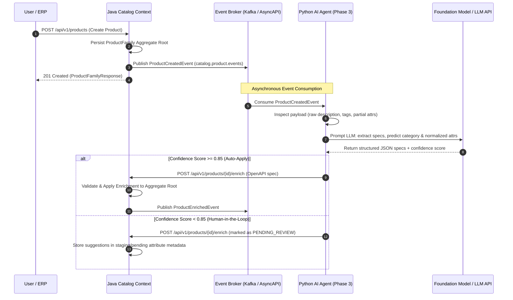

# 3. The Cross-Boundary Workflow (Where Java Meets Python AI)

> **Status:** Specification & Architectural Blueprint (For Phase 3 Implementation)  
> **Target Bounded Contexts:** `catalog-context` (Java Core PIM) ⟷ `ai-python` (Autonomous Agent Worker)  
> **Relevant Contracts:**  
> - [`contracts/openapi/catalog-api.yaml`](file:///home/annguyen/master_projects/DDD-AiAgentFriendly-Capstone2/contracts/openapi/catalog-api.yaml)  
> - [`contracts/asyncapi/catalog-events.yaml`](file:///home/annguyen/master_projects/DDD-AiAgentFriendly-Capstone2/contracts/asyncapi/catalog-events.yaml)

---

## 1. Executive Summary & Design Principles

The PIM system divides responsibilities between two specialized execution environments:

1. **Java Core (`backend-java`)**:
   - **System of Record (SoR)** and transactional authority.
   - Strict Domain-Driven Design (Hexagonal Architecture) with immutable Value Objects, aggregate invariants, and PostgreSQL JSONB persistence.
   - Pure domain models isolated from external systems.
2. **Python AI Agent (`ai-python`)**:
   - **System of Intelligence (SoI)**.
   - Unstructured data extraction, taxonomy prediction, NLP copywriting, and dynamic attribute synthesis powered by LLMs and agentic pipelines.

### Core Architecture Rules:
- **Zero Direct Database Access for AI**: The Python agent **never** accesses PostgreSQL directly. All state mutations must pass through the Java Core domain via validated APIs to enforce invariants.
- **Asynchronous by Default**: Heavy LLM generation runs asynchronously via event choreography over Kafka/RabbitMQ. Synchronous REST is reserved only for interactive UI requests.
- **Idempotency & Auditing**: Every enrichment event carries a unique `eventId`, correlation ID, version, and `source` tag (e.g. `AI-Agent-Enricher-v1`) to prevent duplicate processing and maintain audit trails.

---

## 2. Sequence Diagram: Asynchronous Enrichment Choreography



---

## 3. Data Contract Mapping: Java Value Objects ⟷ Python Pydantic

Both systems share a common schema definition governed by the API contracts:

### 3.1. Dynamic Attributes (`AttributeValue`)
In Java, attributes are modeled as strongly typed Value Objects stored in PostgreSQL JSONB:
```java
// Java Domain Value Object
public final class AttributeValue {
    public enum AttributeType { STRING, NUMBER, BOOLEAN, JSON, LOCALIZED_STRING }
    private final AttributeType type;
    private final Object value;
    private final String unit;
}
```

In Python (Pydantic v2), the equivalent schema is defined for strict validation:
```python
from enum import Enum
from typing import Any, Optional
from pydantic import BaseModel, Field

class AttributeType(str, Enum):
    STRING = "STRING"
    NUMBER = "NUMBER"
    BOOLEAN = "BOOLEAN"
    JSON = "JSON"
    LOCALIZED_STRING = "LOCALIZED_STRING"

class AttributeValueDto(BaseModel):
    type: AttributeType
    value: Any
    unit: Optional[str] = None

class EnrichProductRequest(BaseModel):
    source: str = Field(..., example="AI-Agent-Enricher-v1")
    description: Optional[str] = None
    attributes: dict[str, AttributeValueDto]
    confidence_score: Optional[float] = Field(None, ge=0.0, le=1.0)
```

### 3.2. Standardized Dimensions (`Dimensions`)
```python
class DimensionsDto(BaseModel):
    length: float
    width: float
    height: float
    weight: float
    unit: str = "cm/kg"
```

---

## 4. Enrichment Pipeline Stages (Phase 3 AI Specification)

When Phase 3 is implemented in `ai-python/`, the agent worker should execute the following 5-stage pipeline:

```
+-----------------------------------------------------------------------------+
|                           AI ENRICHMENT PIPELINE                            |
+-----------------------------------------------------------------------------+
|                                                                             |
|  1. Ingestion        Parse incoming ProductCreatedEvent payload             |
|          │                                                                  |
|          ▼                                                                  |
|  2. Classification   Query Taxonomy context API for category candidates;    |
|          │           predict parent node ID                                 |
|          ▼                                                                  |
|  3. Attribute Extr.  Extract technical specs, dimensions, materials,        |
|          │           and convert into typed AttributeValue objects          |
|          ▼                                                                  |
|  4. Copywriting      Generate SEO title, consumer bullets & clean markdown  |
|          │           descriptions                                           |
|          ▼                                                                  |
|  5. Verification     Calculate aggregate confidence score & dispatch to     |
|                      Java API (Auto-Apply or Staging Queue)                 |
+-----------------------------------------------------------------------------+
```

---

## 5. Human-in-the-Loop (HITL) Quality Gate Protocol

To prevent hallucinated data from contaminating the production catalog, the system enforces threshold routing:

| Metric | Threshold | Action |
| :--- | :--- | :--- |
| **High Confidence** | `Score >= 0.85` | Directly merged into `ProductFamily.attributes` via `/enrich` endpoint |
| **Low / Ambiguous** | `Score < 0.85` | Flagged as `NEEDS_REVIEW` under attribute metadata `ai_pending_review` |
| **Contradictory** | Existing Human Value present | AI **never** silently overwrites human-approved values unless `force_override=true` is explicitly authorized |

---

## 6. Failure Modes, Retries & Resilience

1. **Broker Failure**: Events are written using the Transactional Outbox pattern on the Java side to guarantee at-least-once delivery.
2. **LLM Rate Limits / Outages**: The Python worker implements exponential backoff with jitter and a Dead-Letter Queue (`catalog.product.events.dlq`) after 5 failed retry attempts.
3. **Optimistic Locking**: The Java Core domain uses `@Version` optimistic locking. If a concurrent update occurs while AI is processing, the enrichment update will retry with the latest aggregate snapshot.

---

## 7. Phase 3 Pickup Checklist

When development begins for Phase 3:
- [ ] Set up Python virtual environment (`poetry` or `uv`) in `ai-python/`.
- [ ] Implement Kafka / RabbitMQ consumer subscribing to `catalog.product.events`.
- [ ] Implement Pydantic models generated from `contracts/openapi/catalog-api.yaml`.
- [ ] Integrate LLM provider (e.g. Gemini 1.5 Pro / GPT-4o) using LangChain / LlamaIndex structured outputs.
- [ ] Add unit & integration tests mocking Java API endpoints with WireMock or FastAPI test client.
