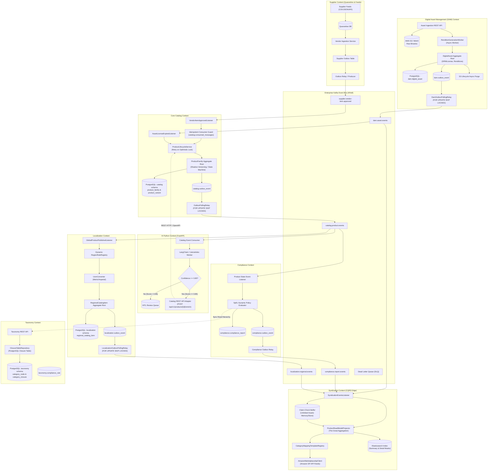
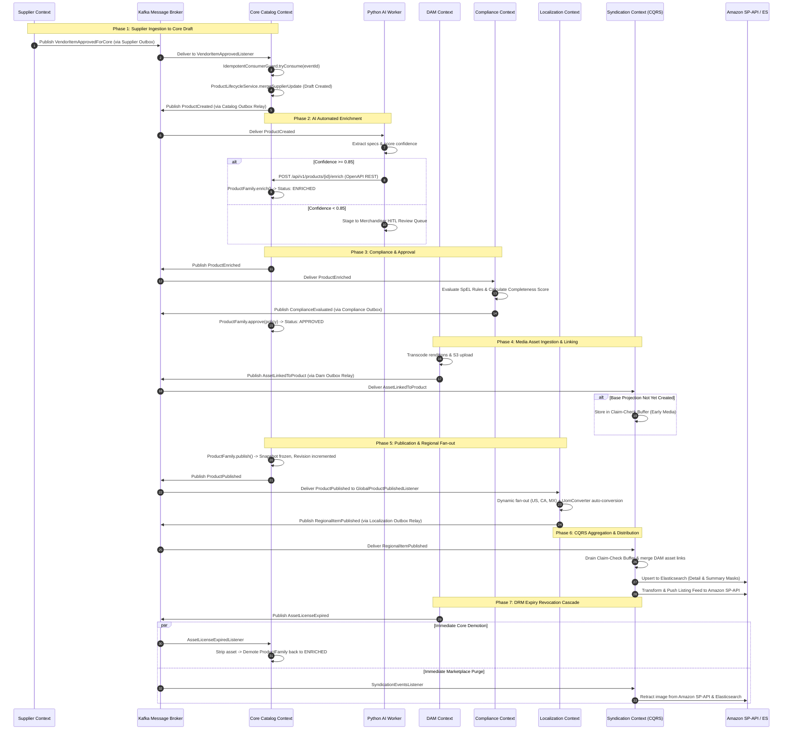

# Architecture Brainstorm & Multi-Context Interaction Map

> **System:** AI-Agent-Friendly Enterprise Product Information Management (PIM) Platform  
> **Architecture:** Domain-Driven Design (DDD), Hexagonal Architecture (Ports & Adapters), Event-Driven Choreography, CQRS Edge  
> **Status:** Working Reference Document for System Evolution & Brainstorming

---

## 1. Executive Context & Scope

This document details the multi-context system boundaries, interaction contracts, persistence topologies, messaging flows, and sidecars across the platform. Use this document as a whiteboard/brainstorming guide to trace data paths and evaluate architectural additions.

### 1.1 Context Boundaries & Responsibilities

| Context | Architectural Responsibility | Key Patterns & Mechanisms |
| :--- | :--- | :--- |
| **`shared-kernel`** | Common domain abstractions & contracts | `AggregateRoot`, `Entity`, `DomainEvent`, `DomainException` |
| **`supplier-context`** | External vendor payload ingestion & quarantine | File parsing, data normalization, vendor approval staging |
| **`catalog-context`** | Core PIM domain model & lifecycle state machine | Shadow versioning (`publishedSnapshot`), transactional outbox poller, idempotent consumer guard, category compliance SPI |
| **`taxonomy-context`** | Product classification & category hierarchy | PostgreSQL Closure Table ($O(1)$ subtrees, cycle-safe moves), rule scope matching |
| **`dam-context`** | Media assets, image transformations, and DRM legal safety | AWS S3 / MinIO binary storage, async transcoding workers, DRM pre-warning timers, transactional outbox |
| **`compliance-context`** | Dynamic regulatory & merchandising scoring | Spring Expression Language (SpEL) dynamic rule engine, hard gate vs soft gate scoring, version-locked compliance reports |
| **`localization-context`** | Global expansion, currency & regional overrides | Dynamic `RegionRuleRegistry`, automated `UomConverter` (metric/imperial), regional fan-out, transactional outbox |
| **`syndication-context`** | CQRS edge read model & external channels | "The Great Aggregation" projector, Claim-Check buffer, Elasticsearch projections (Summary vs Detail masks), Amazon SP-API client |
| **`ai-python`** | Autonomous attribute extraction & enrichment | FastAPI microservice, LangChain/LlamaIndex agents, confidence score threshold ($\ge 0.85$ auto-enrich vs $< 0.85$ HITL review) |

---

## 2. Global System Interaction & Sidecar Topology

The following diagram maps how events move across bounded contexts, how each context coordinates transactional persistence with outbox pollers/sidecars, and how edge adapters feed downstream systems.

---

## 3. End-to-End Choreography Sequence

---

## 4. Current Codebase Implementation Inventory

For code tracing and reference during architectural discussions:

1. **Transactional Outbox Relays:**
   - Catalog: [`OutboxPollingRelay.java`](file:///home/annguyen/master_projects/DDD-AiAgentFriendly-Capstone2/backend-java/catalog-context/src/main/java/com/retail/pim/catalog/infrastructure/persistence/OutboxPollingRelay.java)
   - DAM: [`DamOutboxPollingRelay.java`](file:///home/annguyen/master_projects/DDD-AiAgentFriendly-Capstone2/backend-java/dam-context/src/main/java/com/retail/pim/dam/infrastructure/persistence/DamOutboxPollingRelay.java)
   - Localization: [`LocalizationOutboxPollingRelay.java`](file:///home/annguyen/master_projects/DDD-AiAgentFriendly-Capstone2/backend-java/localization-context/src/main/java/com/retail/pim/localization/infrastructure/persistence/LocalizationOutboxPollingRelay.java)
2. **Listeners & Inbound Adapters:**
   - Vendor Approved: [`VendorItemApprovedListener.java`](file:///home/annguyen/master_projects/DDD-AiAgentFriendly-Capstone2/backend-java/catalog-context/src/main/java/com/retail/pim/catalog/infrastructure/messaging/VendorItemApprovedListener.java)
   - Asset License Expired: [`AssetLicenseExpiredListener.java`](file:///home/annguyen/master_projects/DDD-AiAgentFriendly-Capstone2/backend-java/catalog-context/src/main/java/com/retail/pim/catalog/infrastructure/messaging/AssetLicenseExpiredListener.java)
   - Localization Fan-out: [`GlobalProductPublishedListener.java`](file:///home/annguyen/master_projects/DDD-AiAgentFriendly-Capstone2/backend-java/localization-context/src/main/java/com/retail/pim/localization/infrastructure/messaging/GlobalProductPublishedListener.java)
   - Great Aggregation: [`SyndicationEventsListener.java`](file:///home/annguyen/master_projects/DDD-AiAgentFriendly-Capstone2/backend-java/syndication-context/src/main/java/com/retail/pim/syndication/infrastructure/messaging/SyndicationEventsListener.java)
3. **Core Aggregators & Domain Models:**
   - CQRS Aggregation & Claim-Check Buffer: [`ProductReadModelProjector.java`](file:///home/annguyen/master_projects/DDD-AiAgentFriendly-Capstone2/backend-java/syndication-context/src/main/java/com/retail/pim/syndication/application/projections/ProductReadModelProjector.java)
   - Core Aggregate & Shadow Versioning: [`ProductFamily.java`](file:///home/annguyen/master_projects/DDD-AiAgentFriendly-Capstone2/backend-java/catalog-context/src/main/java/com/retail/pim/catalog/domain/model/ProductFamily.java)
   - Category Hierarchy & Closure Table: [`ClosureTableRepositoryImpl.java`](file:///home/annguyen/master_projects/DDD-AiAgentFriendly-Capstone2/backend-java/taxonomy-context/src/main/java/com/retail/pim/taxonomy/infrastructure/persistence/ClosureTableRepositoryImpl.java)
4. **Database Schemas & Extensions:**
   - DDL definitions: [`01-create-schemas.sql`](file:///home/annguyen/master_projects/DDD-AiAgentFriendly-Capstone2/infra/db-init/01-create-schemas.sql) and [`02-enable-jsonb.sql`](file:///home/annguyen/master_projects/DDD-AiAgentFriendly-Capstone2/infra/db-init/02-enable-jsonb.sql)